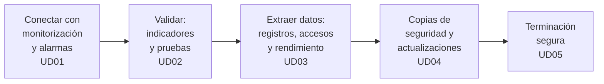

# Mantenimiento del sistema de contenedores desplegado

Apuntes y prácticas del módulo **5169 · Mantenimiento del sistema de contenedores desplegado**, del Curso de especialización de FP de Grado Superior en **Despliegue de productos software en contenedores** (Real Decreto 144/2026), curso **2026/27**.

En el módulo de despliegue se pone el sistema en marcha. Aquí empieza el **día 2**: el sistema ya está en producción y tu trabajo es **mantenerlo vivo**. Lo vigilas, compruebas que rinde lo que debe, lees lo que te cuentan los registros, haces copias y actualizaciones sin perder datos y, cuando llega el momento, lo **das de baja** sin dejar rastro.

> [!NOTE]
> Este módulo forma parte del curso de especialización junto con [Despliegue de plataformas de ejecución de contenedores (5166)](https://lorenalresusta.github.io/Despliegue-Contenedores/). La [relación entre los dos módulos](/guia/relacion-modulos/) enlaza cada concepto con el otro, y el [portal de FP](https://lorenalresusta.github.io/FP/) reúne todas las asignaturas por ciclo.

| Característica | Valor |
|---|---|
| **Módulo** | 5169 · 45 horas · 6 ECTS |
| **Resultados de aprendizaje** | 5 (RA1 a RA5), oficiales del RD 144/2026. Consulta la [guía](/guia/ra-ce/) |
| **Entorno de laboratorio** | VirtualBox 7 · Debian 13 · Docker Engine · kind · Helm · Prometheus, Alertmanager, Grafana y Loki · Garage · Velero · Trivy · k6 |
| **Sistema que mantienes** | [BiciAlacant, ya desplegado en producción](/guia/proyecto-bicialacant/) |

> [!NOTE]
> Todo el módulo sigue el mismo hilo: **observar → medir → diagnosticar → proteger y actualizar → retirar**. No vas a instalar la aplicación desde cero: la recibes funcionando y con un **libro de operaciones** (*runbook*) que vas completando unidad a unidad.

## El hilo del módulo

## Unidades didácticas

Cada unidad tiene una página de **teoría** y una de **prácticas** clasificadas en **guiadas**, **autónomas**, **retos** y **tarea del proyecto**, con su ficha de duración, dificultad, RA/CE, software y entrega.

  
RA1 · 9 h<h3>UD01 · Integración con monitorización y alarmas</h3>
Exportadores y ServiceMonitor, umbrales, reglas de agregación, Alertmanager, categorización de alarmas y auditoría de puertos.

<a href="ud01-monitorizacion-alarmas/ud01-teoria/">Teoría</a> · <a href="ud01-monitorizacion-alarmas/ud01-practicas/">Prácticas</a>

  
RA2 · 9 h<h3>UD02 · Validación del sistema desplegado</h3>
Catálogo de métricas, indicadores (SLI/SLO) con PromQL, catálogo de alarmas y pruebas funcionales, de carga, estrés y seguridad.

<a href="ud02-validacion-sistema/">Unidad</a>

  
RA3 · 8 h<h3>UD03 · Extracción de datos</h3>
Revisión periódica de registros con Loki, accesos y fuerza bruta, reinicios y volcados, rendimiento de nodos y contenedores.

<a href="ud03-extraccion-datos/">Unidad</a>

  
RA4 · 12 h<h3>UD04 · Copias de seguridad y actualizaciones</h3>
CronJobs de copia, Garage y rotación, restauración en un entorno de pruebas, Trivy, parches, actualización sin pérdida y trazabilidad.

<a href="ud04-backup-actualizaciones/">Unidad</a>

  
RA5 · 7 h<h3>UD05 · Terminación del contenedor</h3>
Baja ordenada, liberación de recursos, borrado seguro de copias, registros y datos sensibles, desintegración de la monitorización y práctica final.

<a href="ud05-terminacion/">Unidad</a>

## Relación entre unidades y resultados de aprendizaje

| Unidad | RA1 | RA2 | RA3 | RA4 | RA5 | Horas |
|---|:-:|:-:|:-:|:-:|:-:|--:|
| UD01 Integración con monitorización y alarmas | ● | ○ | | | | 9 |
| UD02 Validación del sistema desplegado | ○ | ● | | | | 9 |
| UD03 Extracción de datos | | ○ | ● | | | 8 |
| UD04 Copias de seguridad y actualizaciones | | ○ | | ● | | 12 |
| UD05 Terminación y práctica final | ○ | | | ○ | ● | 7 |
| **Total** | | | | | | **45** |

● contribución principal · ○ contribución secundaria. El detalle por criterio está en [Resultados de aprendizaje y criterios de evaluación](/guia/ra-ce/).

## Cómo leer estos apuntes

> [!TIP]
> **Consejo.** Una forma más cómoda o más profesional de hacer algo.

> [!WARNING]
> **Atención.** Un error habitual o algo que puede dar problemas.

> [!IMPORTANT]
> **Clave.** Un concepto imprescindible para el resultado de aprendizaje.

> [!CAUTION]
> **Peligro.** Una operación que puede destruir datos o dejarte sin acceso. Haz antes una instantánea de la máquina virtual.

Las órdenes de los bloques de código se escriben **sin indicador de prompt** para que puedas copiarlas tal cual. Cuando una orden necesita privilegios aparece con `sudo`. Si se muestra la salida esperada, va en un bloque aparte marcado como `text`.
