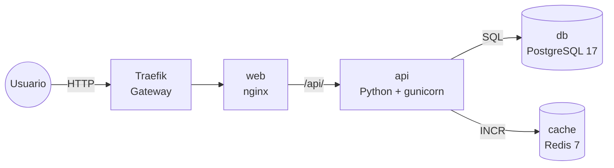

# Sistema que mantienes: BiciAlacant

**BiciAlacant** es el servicio (ficticio) de alquiler de bicicletas de la ciudad. El equipo de despliegue ya lo ha contenerizado y lo ha puesto **en producción** en un clúster Kubernetes. El ayuntamiento te contrata ahora como **técnico de operaciones**: tienes que mantenerlo funcionando, demostrar que rinde lo que se pactó, protegerlo con copias y actualizaciones y, al final del contrato, darlo de baja de forma segura.

> [!NOTE]
> Si has cursado el módulo de **Despliegue** (5166), es la misma aplicación que desplegaste allí. Si no, no pasa nada: el [script de arranque](/guia/entorno/#4-poner-bicialacant-en-producción) la deja lista en unos minutos.

## 1. La aplicación

| Servicio | Qué hace | Qué tienes que vigilar |
|---|---|---|
| `web` | Sirve la página y reenvía `/api/` | Errores 5xx, tiempo de respuesta |
| `api` | Lista estaciones, alquila bicis, cuenta visitas | Peticiones por segundo, latencia, errores, reinicios |
| `db` | Guarda estaciones y bicis libres (**con estado**) | Conexiones, espacio en disco, **copias de seguridad** |
| `cache` | Contador de visitas | Memoria, disponibilidad |

`/api/salud` comprueba la base de datos y la caché. En la UD01 la API pasa a la **versión 1.1.0**, que publica sus métricas en `/metrics`, y en la UD04 la actualizarás en producción sin perder datos.

## 2. Ficheros






## 3. El libro de operaciones (*runbook*)

Cada unidad termina con una **tarea del proyecto** que añade un capítulo al libro de operaciones, un repositorio Git con documentos Markdown:

| Unidad | Capítulo del libro de operaciones | Resultado |
|---|---|---|
| UD01 | `01-monitorizacion.md` | Qué se mide, dónde, con qué umbrales; cómo llegan y se clasifican las alarmas; puertos permitidos |
| UD02 | `02-indicadores-y-pruebas.md` | Catálogo de métricas, indicadores y alarmas con su procedimiento de resolución; informe de pruebas |
| UD03 | `03-revision-periodica.md` | Qué se revisa cada día y cada semana, cómo se automatiza y qué hacer con lo que aparece |
| UD04 | `04-copias-y-actualizaciones.md` | Política de copias, prueba de restauración y registro de cambios de versión |
| UD05 | `05-baja-del-servicio.md` | Procedimiento de terminación y certificado de borrado |

## 4. Acuerdo de nivel de servicio (lo que pide el cliente)

1. **Disponibilidad** mensual de la web ≥ 99,5 %.
2. **Latencia**: el 95 % de las peticiones a la API responde en menos de 300 ms.
3. **Errores**: menos del 1 % de respuestas 5xx en cualquier ventana de 5 minutos.
4. **Datos**: se puede perder como mucho **24 horas** de datos (RPO) y el servicio se recupera en menos de **1 hora** (RTO).
5. **Seguridad**: ninguna vulnerabilidad *crítica* sin corregir más de 7 días; accesos fallidos repetidos bloqueados.
6. **Baja**: al terminar el contrato no queda ningún dato personal recuperable.
