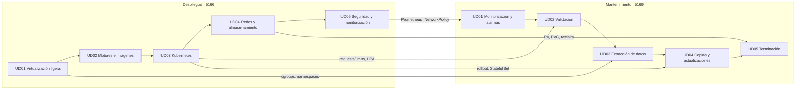

# Relación entre Despliegue y Mantenimiento

El curso de especialización en **Despliegue de productos software en contenedores** tiene dos módulos que trabajan sobre la **misma aplicación**, BiciAlacant, con dos papeles distintos:

| | [Despliegue (5166)](https://lorenalresusta.github.io/Despliegue-Contenedores/) | [Mantenimiento (5169)](https://lorenalresusta.github.io/Mantenimiento-Contenedores/) |
|---|---|---|
| Papel | Equipo que **construye y pone en marcha** la plataforma | Técnico de **operaciones** que la recibe en producción |
| BiciAlacant | De un `docker run` a un clúster en alta disponibilidad | Se observa, se valida, se protege, se actualiza y se da de baja |
| Resultado | Clúster y aplicación desplegados | Libro de operaciones del servicio |

En los apuntes, cada concepto relacionado lleva un recuadro **«Repaso · lo viste en Despliegue»** o **«Continúa en Mantenimiento»** que enlaza con el apartado del otro módulo.

## Correspondencia de conceptos

| Concepto | Dónde se aprende (Despliegue) | Dónde se aplica en producción (Mantenimiento) |
|---|---|---|
| Namespaces y cgroups | [UD01 · Namespaces](https://lorenalresusta.github.io/Despliegue-Contenedores/ud01-virtualizacion-ligera/ud01-teoria/#4-namespaces-lo-que-el-proceso-ve) · [cgroups](https://lorenalresusta.github.io/Despliegue-Contenedores/ud01-virtualizacion-ligera/ud01-teoria/#5-cgroups-lo-que-el-proceso-puede-usar) | [UD03 · OOMKilled y reinicios](https://lorenalresusta.github.io/Mantenimiento-Contenedores/ud03-extraccion-datos/ud03-teoria/#5-fallos-y-reinicios-de-la-aplicación) · [kubectl debug](https://lorenalresusta.github.io/Mantenimiento-Contenedores/ud03-extraccion-datos/ud03-teoria/#52-volcados-ver-qué-hacía-el-proceso) |
| Depuración y registros de un contenedor | [UD02 · Depuración](https://lorenalresusta.github.io/Despliegue-Contenedores/ud02-motores-contenedores/ud02-teoria/#33-depuración) | [UD03 · Registros, Loki y LogQL](https://lorenalresusta.github.io/Mantenimiento-Contenedores/ud03-extraccion-datos/ud03-teoria/#1-registros-en-un-sistema-de-contenedores) |
| Etiquetas e imágenes | [UD02 · Estrategia de etiquetado](https://lorenalresusta.github.io/Despliegue-Contenedores/ud02-motores-contenedores/ud02-teoria/#42-estrategia-de-etiquetado) · [Varias etapas](https://lorenalresusta.github.io/Despliegue-Contenedores/ud02-motores-contenedores/ud02-teoria/#55-construcción-en-varias-etapas-multi-stage) | [UD04 · Versiones, parches y etiquetas](https://lorenalresusta.github.io/Mantenimiento-Contenedores/ud04-backup-actualizaciones/ud04-teoria/#71-versiones-semánticas-y-etiquetas) |
| Configuración y secretos | [UD02 · Configuración y secretos](https://lorenalresusta.github.io/Despliegue-Contenedores/ud02-motores-contenedores/ud02-teoria/#7-configuración-y-secretos) · [UD05 · Gestión de secretos](https://lorenalresusta.github.io/Despliegue-Contenedores/ud05-seguridad-monitorizacion/ud05-teoria/#7-gestión-de-secretos) | [UD04 · Qué hay que copiar](https://lorenalresusta.github.io/Mantenimiento-Contenedores/ud04-backup-actualizaciones/ud04-teoria/#2-qué-hay-que-copiar-en-un-sistema-de-contenedores) |
| Sondas | [UD03 · Sondas](https://lorenalresusta.github.io/Despliegue-Contenedores/ud03-kubernetes/ud03-teoria/#81-sondas-probes) | [UD03 · Diagnóstico de reinicios](https://lorenalresusta.github.io/Mantenimiento-Contenedores/ud03-extraccion-datos/ud03-teoria/#5-fallos-y-reinicios-de-la-aplicación) |
| *Requests* y *limits* | [UD03 · Requests y limits](https://lorenalresusta.github.io/Despliegue-Contenedores/ud03-kubernetes/ud03-teoria/#82-requests-y-limits) | [UD02 · Indicadores de capacidad](https://lorenalresusta.github.io/Mantenimiento-Contenedores/ud02-validacion-sistema/ud02-teoria/#4-indicadores-con-promql) · [UD03 · Rendimiento](https://lorenalresusta.github.io/Mantenimiento-Contenedores/ud03-extraccion-datos/ud03-teoria/#6-rendimiento-de-nodos-y-contenedores) |
| Escalado (HPA) | [UD03 · Escalado](https://lorenalresusta.github.io/Despliegue-Contenedores/ud03-kubernetes/ud03-teoria/#10-escalado) | [UD02 · Pruebas de estrés](https://lorenalresusta.github.io/Mantenimiento-Contenedores/ud02-validacion-sistema/ud02-teoria/#62-pruebas-de-estrés-y-punto-de-rotura) |
| Actualizaciones y vuelta atrás | [UD03 · Actualizaciones y vuelta atrás](https://lorenalresusta.github.io/Despliegue-Contenedores/ud03-kubernetes/ud03-teoria/#9-actualizaciones-y-vuelta-atrás) | [UD04 · Actualizar sin perder datos](https://lorenalresusta.github.io/Mantenimiento-Contenedores/ud04-backup-actualizaciones/ud04-teoria/#8-actualizar-sin-perder-datos) |
| Helm | [UD03 · Helm y Kustomize](https://lorenalresusta.github.io/Despliegue-Contenedores/ud03-kubernetes/ud03-teoria/#11-empaquetado-helm-y-kustomize) | [UD01 · kube-prometheus-stack](https://lorenalresusta.github.io/Mantenimiento-Contenedores/ud01-monitorizacion-alarmas/ud01-teoria/#2-cómo-llegan-los-datos-el-modelo-pull-de-prometheus) |
| Services y Gateway API | [UD04 · Services](https://lorenalresusta.github.io/Despliegue-Contenedores/ud04-redes-almacenamiento/ud04-teoria/#3-services) · [Gateway API](https://lorenalresusta.github.io/Despliegue-Contenedores/ud04-redes-almacenamiento/ud04-teoria/#42-gateway-api) | [UD01 · ServiceMonitor](https://lorenalresusta.github.io/Mantenimiento-Contenedores/ud01-monitorizacion-alarmas/ud01-teoria/#2-cómo-llegan-los-datos-el-modelo-pull-de-prometheus) · [UD03 · La IP detrás del proxy](https://lorenalresusta.github.io/Mantenimiento-Contenedores/ud03-extraccion-datos/ud03-teoria/#41-fuerza-bruta-detectar-y-bloquear) |
| PV, PVC y política de recuperación | [UD04 · Volúmenes persistentes](https://lorenalresusta.github.io/Despliegue-Contenedores/ud04-redes-almacenamiento/ud04-teoria/#62-volúmenes-persistentes-pv-pvc-y-storageclass) · [Recuperación](https://lorenalresusta.github.io/Despliegue-Contenedores/ud04-redes-almacenamiento/ud04-teoria/#63-modos-de-acceso-y-política-de-recuperación) | [UD04 · Copia de volúmenes](https://lorenalresusta.github.io/Mantenimiento-Contenedores/ud04-backup-actualizaciones/ud04-teoria/#21-copia-lógica-frente-a-copia-de-volumen) · [UD05 · Lo que sobrevive a un borrado](https://lorenalresusta.github.io/Mantenimiento-Contenedores/ud05-terminacion/ud05-teoria/#2-lo-que-sobrevive-a-kubectl-delete) |
| Cadena de suministro | [UD05 · Cadena de suministro](https://lorenalresusta.github.io/Despliegue-Contenedores/ud05-seguridad-monitorizacion/ud05-teoria/#2-cadena-de-suministro-de-imágenes) | [UD04 · CVE, SBOM y Trivy](https://lorenalresusta.github.io/Mantenimiento-Contenedores/ud04-backup-actualizaciones/ud04-teoria/#72-vulnerabilidades-cve-sbom-y-escáneres) |
| Autenticación y RBAC | [UD05 · Control de acceso](https://lorenalresusta.github.io/Despliegue-Contenedores/ud05-seguridad-monitorizacion/ud05-teoria/#4-control-de-acceso-autenticación-y-rbac) | [UD03 · Accesos fallidos](https://lorenalresusta.github.io/Mantenimiento-Contenedores/ud03-extraccion-datos/ud03-teoria/#4-accesos-al-sistema) |
| Políticas de red | [UD05 · Políticas de red](https://lorenalresusta.github.io/Despliegue-Contenedores/ud05-seguridad-monitorizacion/ud05-teoria/#6-políticas-de-red) | [UD01 · Proteger la monitorización](https://lorenalresusta.github.io/Mantenimiento-Contenedores/ud01-monitorizacion-alarmas/ud01-teoria/#72-reglas-de-protección) |
| Prometheus y registros | [UD05 · Observabilidad](https://lorenalresusta.github.io/Despliegue-Contenedores/ud05-seguridad-monitorizacion/ud05-teoria/#8-observabilidad) | [UD01 · Monitorización y alarmas](https://lorenalresusta.github.io/Mantenimiento-Contenedores/ud01-monitorizacion-alarmas/ud01-teoria/) · [UD02 · SLO](https://lorenalresusta.github.io/Mantenimiento-Contenedores/ud02-validacion-sistema/ud02-teoria/#3-del-acuerdo-de-nivel-de-servicio-a-los-indicadores) · [UD05 · Desintegración](https://lorenalresusta.github.io/Mantenimiento-Contenedores/ud05-terminacion/ud05-teoria/#5-desintegrar-la-monitorización) |
| Alta disponibilidad | [UD05 · Alta disponibilidad](https://lorenalresusta.github.io/Despliegue-Contenedores/ud05-seguridad-monitorizacion/ud05-teoria/#9-alta-disponibilidad-y-tolerancia-a-fallos) | [UD04 · RPO, RTO y copias](https://lorenalresusta.github.io/Mantenimiento-Contenedores/ud04-backup-actualizaciones/ud04-teoria/#1-rpo-rto-y-política-de-copias) |

> [!TIP]
> Si cursas los dos módulos a la vez, el [portal de FP](https://lorenalresusta.github.io/FP/) reúne todos los módulos por ciclo.
