# Temporalización

El módulo dura **45 horas**. Aproximadamente un **30 %** es teoría (explicación, demostraciones y autoevaluación) y un **70 %** es laboratorio sobre el sistema en producción.

| Unidad | Teoría | Prácticas | Total | RA |
|---|--:|--:|--:|---|
| [UD01 · Integración con monitorización y alarmas](/ud01-monitorizacion-alarmas/) | 3 h | 6 h | **9 h** | RA1 |
| [UD02 · Validación del sistema desplegado](/ud02-validacion-sistema/) | 3 h | 6 h | **9 h** | RA2 |
| [UD03 · Extracción de datos](/ud03-extraccion-datos/) | 2 h | 6 h | **8 h** | RA3 |
| [UD04 · Copias de seguridad y actualizaciones](/ud04-backup-actualizaciones/) | 4 h | 8 h | **12 h** | RA4 |
| [UD05 · Terminación del contenedor y práctica final](/ud05-terminacion/) | 1 h | 6 h | **7 h** | RA5 |
| **Total** | **13 h** | **32 h** | **45 h** | |

```mermaid
gantt
    title Reparto de las 45 horas (en horas acumuladas)
    dateFormat X
    axisFormat %s h
    section UD01
    Monitorización y alarmas   :0, 9
    section UD02
    Validación                 :9, 18
    section UD03
    Extracción de datos        :18, 26
    section UD04
    Backup y actualizaciones   :26, 38
    section UD05
    Terminación y práctica final :38, 45
```

## Organización de una unidad

1. **Presentación** (10 min): qué tarea de operación resuelve la unidad y qué RA trabaja.
2. **Teoría por bloques**, cada uno con una demostración sobre BiciAlacant.
3. **Prácticas guiadas** en el laboratorio, con lista de comprobación.
4. **Prácticas autónomas y retos**: aplicas la técnica sin el procedimiento escrito.
5. **Tarea del proyecto**: añades tu capítulo al **libro de operaciones** de BiciAlacant.
6. **Autoevaluación** y prueba de la unidad.

## Hitos

| Hito | Cuándo | Qué se comprueba |
|---|---|---|
| H0 · Producción en marcha | Primera sesión | BiciAlacant responde en `http://bicialacant.local` ([entorno](/guia/entorno/)) |
| H1 · Sistema observado | Final de la UD01 | Métricas en Prometheus, panel en Grafana y una alarma que llega categorizada |
| H2 · Sistema validado | Final de la UD02 | Catálogo de indicadores y alarmas, e informe de pruebas con evidencias |
| H3 · Diagnóstico | Final de la UD03 | Revisión periódica automatizada de registros, accesos y rendimiento |
| H4 · Protegido y al día | Final de la UD04 | Copia restaurada en un clúster de pruebas y actualización sin pérdida de datos |
| H5 · Práctica final | Final de la UD05 | Libro de operaciones completo y baja segura del sistema |

> [!TIP]
> Con un horario de 3 h semanales, el módulo ocupa unas 15 semanas: UD01 3 · UD02 3 · UD03 2,5 · UD04 4 · UD05 2,5.
