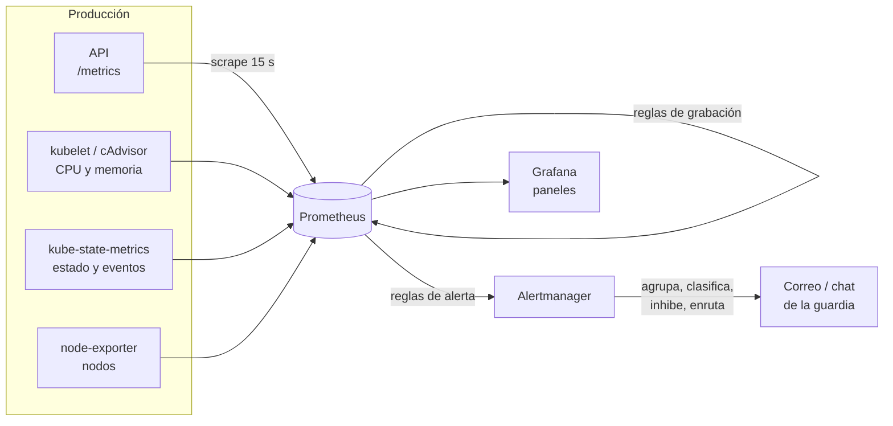
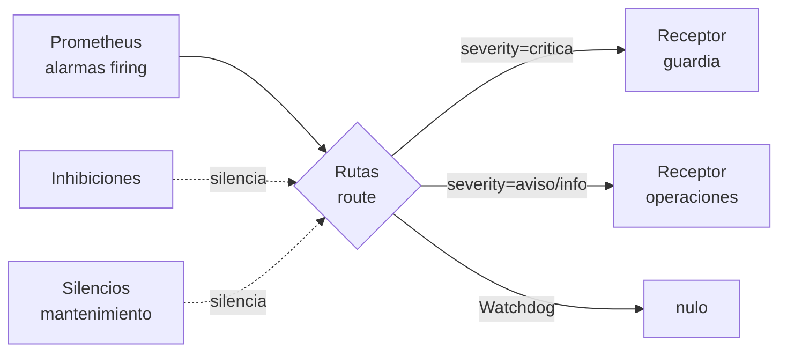

# UD01 · Integración con monitorización y alarmas

## Resumen del tema

BiciAlacant ya está en producción. Lo primero que hace un técnico de operaciones con un sistema que hereda es **conectarlo a los sistemas de monitorización y de alarmas**: que cada contenedor envíe sus datos, que esos datos lleguen íntegros y se guarden, que haya **umbrales** que separen lo normal de lo anormal, que los **eventos** se conviertan en **alarmas clasificadas** que avisan a quien corresponde, y que todo ese tráfico de vigilancia esté **auditado y protegido**. Sin esto, el resto del módulo (validar, diagnosticar, copiar, actualizar) se haría a ciegas.



### Objetivos de aprendizaje

- Distinguir métricas, eventos y registros, y saber qué sistema recoge cada uno.
- Explicar cómo llegan los datos de un contenedor a Prometheus y comprobar que se almacenan.
- Configurar umbrales sobre contadores y sobre cadenas de texto de los eventos.
- Crear indicadores nuevos agregando y correlacionando contadores.
- Enviar los eventos a Alertmanager y clasificarlos por fecha, origen y criticidad.
- Auditar los puertos y protocolos de la monitorización y restringirlos con políticas de red.

---

## 1. Qué significa «monitorizar» un sistema de contenedores

Un contenedor es efímero: nace, muere, se reprograma en otro nodo y cambia de IP. Por eso **no se monitoriza un servidor**, se monitoriza un **servicio** formado por muchas réplicas que van y vienen. La información que produce se agrupa en tres tipos de señales:

| Señal | Qué es | Ejemplo en BiciAlacant | Dónde va |
|---|---|---|---|
| **Métrica** | Número que se mide cada cierto tiempo, con nombre y etiquetas | `bicialacant_peticiones_total{ruta="/api/estaciones", codigo="200"} 1532` | Prometheus |
| **Evento** | Algo que ha ocurrido en un instante, con un texto que lo describe | El contenedor `api` terminó con motivo `OOMKilled` | Kubernetes (eventos y estado) → métricas de kube-state-metrics → Alertmanager |
| **Registro** (*log*) | Línea de texto que escribe la aplicación | `ERROR SALUD db no disponible: OperationalError` | Loki (UD03) |

Una **alarma** es la combinación de una señal y una **regla**: «si la tasa de errores supera el 1 % durante 2 minutos, avisa». La alarma tiene que llegar a una persona con la información necesaria para actuar: qué pasa, dónde, desde cuándo y cuánto de grave es.



> [!IMPORTANT]
> **Monitorización ≠ alarmas.** La monitorización **recoge y guarda** datos; el sistema de alarmas **decide cuándo un dato es un problema** y a quién avisar. En la pila que usamos, Prometheus hace lo primero (y evalúa las reglas) y **Alertmanager** hace lo segundo.

## 2. Cómo llegan los datos: el modelo *pull* de Prometheus



Prometheus **pregunta** a cada objetivo (*target*) cada pocos segundos: hace un `GET /metrics` y guarda lo que recibe. A esto se le llama ***scrape***. La aplicación no envía nada: solo publica sus contadores en texto plano.

```text
# HELP bicialacant_peticiones_total Peticiones HTTP atendidas por la API
# TYPE bicialacant_peticiones_total counter
bicialacant_peticiones_total{codigo="200",metodo="GET",ruta="/api/estaciones"} 1532.0
bicialacant_peticiones_total{codigo="409",metodo="POST",ruta="/api/alquiler/<int:id_estacion>"} 4.0
# HELP bicialacant_dependencia_activa 1 si la dependencia respondió en la última comprobación de salud, 0 si no
# TYPE bicialacant_dependencia_activa gauge
bicialacant_dependencia_activa{dependencia="db"} 1.0
```

### 2.1 Exportadores

No todo software publica `/metrics`. Para eso existen los **exportadores**: pequeños programas que traducen el estado de otro sistema al formato de Prometheus.

| Exportador | Qué traduce | Cómo se despliega |
|---|---|---|
| node-exporter | CPU, memoria, disco y red de cada **nodo** | DaemonSet (uno por nodo) |
| cAdvisor (dentro del kubelet) | Consumo de cada **contenedor** | Viene con Kubernetes |
| kube-state-metrics | **Estado** de los objetos: réplicas, reinicios, motivos de terminación | Deployment |
| postgres-exporter, redis-exporter | Estado de la **base de datos** y de la **caché** | Contenedor *sidecar* o Deployment aparte |

La **API 1.1.0** de BiciAlacant incluye la biblioteca `prometheus-client` y publica sus propias métricas: es lo que se llama **instrumentar** una aplicación.

### 2.2 Descubrimiento de objetivos: ServiceMonitor



En Kubernetes las IP de los Pods cambian, así que no se le dan IP a Prometheus. El **Prometheus Operator** (incluido en *kube-prometheus-stack*) añade un objeto que describe **qué medir**:

```yaml
apiVersion: monitoring.coreos.com/v1
kind: ServiceMonitor
metadata:
  name: bicialacant-api
  namespace: bicialacant
spec:
  selector:
    matchLabels: {app: api}     # los Services con esta etiqueta…
  endpoints:
    - port: http                # …en su puerto llamado «http»…
      path: /metrics            # …en esta ruta…
      interval: 15s             # …cada 15 segundos
```

El operador busca el Service, obtiene sus **Endpoints** (las IP de los Pods listos) y configura Prometheus. Cada réplica aparece como un objetivo distinto con la etiqueta `pod`.

### 2.3 Comprobar la integración de extremo a extremo

Que el ServiceMonitor exista no prueba nada. La integración se comprueba en **cuatro puntos**:

| Punto | Pregunta | Cómo se comprueba |
|---|---|---|
| 1. Origen | ¿El contenedor publica datos correctos? | `curl` a `/metrics` desde dentro del clúster |
| 2. Red | ¿Prometheus llega al contenedor? | Estado del objetivo en *Status → Targets*: `UP`, duración del *scrape* |
| 3. Integridad | ¿Lo recibido es lo enviado? | Comparar el valor de un contador en `/metrics` con el mismo en Prometheus; `scrape_samples_scraped` |
| 4. Almacenamiento | ¿Se guarda en el sistema remoto? | Consultar el rango de los últimos minutos; la serie no tiene huecos |

Prometheus añade a cada objetivo series automáticas que sirven para auditar la comunicación:

| Serie | Significado |
|---|---|
| `up` | 1 si el último *scrape* fue bien, 0 si falló |
| `scrape_duration_seconds` | Cuánto tardó en responder el objetivo |
| `scrape_samples_scraped` | Cuántas muestras se recibieron |
| `scrape_samples_post_metric_relabeling` | Cuántas se guardaron tras el filtrado |

> [!WARNING]
> **Cardinalidad.** Cada combinación distinta de etiquetas es una serie nueva que ocupa memoria. Por eso la API etiqueta las rutas con su **plantilla** (`/api/alquiler/<int:id_estacion>`) y no con la URL real: con la URL, cada estación crearía series nuevas. Nunca uses como etiqueta un identificador de usuario, una IP de cliente o una marca de tiempo.

## 3. Contadores, medidores e histogramas

El tipo de una métrica decide qué operaciones tienen sentido:

| Tipo | Comportamiento | Ejemplo | Cómo se usa |
|---|---|---|---|
| **Counter** | Solo sube (vuelve a 0 si el proceso reinicia) | `bicialacant_peticiones_total` | Siempre con `rate()` o `increase()`: el valor absoluto no dice nada |
| **Gauge** | Sube y baja | `bicialacant_bicis_libres`, memoria usada | Se compara directamente con un umbral |
| **Histogram** | Cuenta observaciones en «cubos» (`_bucket`, `_sum`, `_count`) | `bicialacant_duracion_peticion_segundos` | Percentiles con `histogram_quantile()` |
| **Info** | Etiquetas constantes con valor 1 | `bicialacant_build_info{version="1.1.0"}` | Saber qué versión corre en cada Pod |

```text
rate(bicialacant_peticiones_total[5m])                       # peticiones por segundo (media de 5 min)
increase(kube_pod_container_status_restarts_total[1h])       # reinicios en la última hora
histogram_quantile(0.95, sum by (le) (rate(bicialacant_duracion_peticion_segundos_bucket[5m])))
```

## 4. Umbrales

Un **umbral** es el valor a partir del cual un indicador deja de ser normal. Los umbrales **no se inventan**: salen de la **documentación** (el acuerdo de nivel de servicio, las especificaciones del fabricante, la capacidad medida en las pruebas).

| Indicador (BiciAlacant) | Umbral de aviso | Umbral crítico | Fuente |
|---|---|---|---|
| Respuestas 5xx | > 1 % durante 2 min | > 5 % durante 2 min | Acuerdo de servicio, punto 3 |
| Latencia p95 de la API | > 300 ms durante 5 min | — | Acuerdo de servicio, punto 2 |
| Réplicas de la API que publican métricas | — | 0 durante 1 min | Acuerdo de servicio, punto 1 |
| Estación sin bicis | 0 durante 10 min (informativo) | — | Petición del servicio de movilidad |

Una regla de alerta en Prometheus tiene cuatro partes:

```yaml
- alert: BiciAlacantErroresAltos            # nombre
  expr: bicialacant:errores:ratio5m > 0.01   # condición: indicador y umbral
  for: 2m                                    # duración: evita avisar por un pico de 10 s
  labels: {severity: aviso, categoria: rendimiento, origen: api}   # clasificación
  annotations:
    summary: "Más del 1 % de respuestas 5xx ({{ $value | humanizePercentage }})"   # texto para la persona
```

Una alarma pasa por tres estados: **inactive** (la condición no se cumple), **pending** (se cumple, pero aún no durante `for`) y **firing** (se envía a Alertmanager).

### 4.1 Umbrales sobre cadenas de texto de los eventos

Hay eventos que no son números sino **textos**: el motivo por el que terminó un contenedor (`OOMKilled`, `Error`, `Completed`) o por el que espera (`CrashLoopBackOff`, `ImagePullBackOff`). kube-state-metrics los convierte en series con el texto en una etiqueta, y la regla busca la **cadena**:

```text
kube_pod_container_status_last_terminated_reason{namespace="bicialacant", reason="OOMKilled"} == 1
kube_pod_container_status_waiting_reason{namespace="bicialacant", reason=~"CrashLoopBackOff|ImagePullBackOff"} == 1
```

`=~` acepta una expresión regular: así una sola regla cubre varias cadenas. En la UD03 harás lo mismo sobre el texto de los **registros** con Loki.

## 5. Indicadores derivados: agregado y correlación

Los contadores en bruto rara vez responden a la pregunta que interesa. Un **indicador derivado** combina varios:

| Operación | Ejemplo | Para qué |
|---|---|---|
| **Agregar** (sumar réplicas) | `sum(rate(bicialacant_peticiones_total[5m]))` | Carga total del servicio, sin importar cuántas réplicas haya |
| **Agrupar** | `sum by (ruta) (…)` | Carga por funcionalidad |
| **Cociente** | errores 5xx ÷ peticiones totales | Tasa de errores (porcentaje) |
| **Correlacionar** dos fuentes | CPU de los contenedores `api` ÷ peticiones por segundo | Coste en CPU de cada petición: si sube sin que suba la carga, algo ha empeorado |

Calcular estas expresiones en cada panel y en cada alarma es lento y propicia errores. Las **reglas de grabación** (*recording rules*) las calculan cada 30 s y guardan el resultado como una serie nueva con un nombre que sigue la convención `nivel:métrica:operación`:

```yaml
- record: bicialacant:errores:ratio5m
  expr: |
    sum(rate(bicialacant_peticiones_total{codigo=~"5.."}[5m]))
    / sum(rate(bicialacant_peticiones_total[5m]))
```

A partir de ahí, alarmas y paneles usan `bicialacant:errores:ratio5m`: si cambias la fórmula, cambia en todas partes.

## 6. Gestión de alarmas con Alertmanager

Prometheus envía a Alertmanager las alarmas en estado *firing*. Alertmanager **no evalúa nada**: se encarga de que la alarma llegue bien.



| Función | Qué hace | Ejemplo |
|---|---|---|
| **Agrupación** (`group_by`) | Junta en una notificación las alarmas con las mismas etiquetas | 3 réplicas fallando = 1 correo, no 3 |
| **Enrutado** (`routes`) | Decide el receptor según las etiquetas | Las críticas a la guardia; los avisos al equipo |
| **Inhibición** | Si salta A, no avises de B | Si la API está caída, no avises de que su latencia es alta |
| **Silencio** | Calla temporalmente unas alarmas | Durante una ventana de mantenimiento planificada |
| **Repetición** | Recuerda las que siguen activas | Cada hora para las críticas |
| **Resolución** | Avisa cuando la alarma deja de cumplirse | `send_resolved: true` |

### 6.1 Categorizar los eventos

Para que una alarma se pueda **notificar y tratar**, debe llevar etiquetas que permitan agruparla y ordenarla:

| Criterio | Dónde está | Valores en BiciAlacant |
|---|---|---|
| **Fecha de creación** | `startsAt` (la pone Prometheus) | Momento en que pasó a *firing* |
| **Origen** | etiquetas `namespace`, `pod` y `origen` | `web`, `api`, `db`, `cache`, `plataforma` |
| **Criticidad** | etiqueta `severity` | `critica` (actuar ya), `aviso` (actuar hoy), `info` (registrar) |
| **Categoría** | etiqueta `categoria` | `disponibilidad`, `rendimiento`, `capacidad`, `estabilidad` |

> [!TIP]
> Pon la criticidad pensando en **quién tiene que levantarse**: una alarma crítica despierta a la guardia, así que solo debe serlo si los usuarios ya están afectados. Si todas las alarmas son críticas, ninguna lo es.

### 6.2 Comprobar que la alarma llega

La integración con el sistema de alarmas se prueba igual que la de monitorización, punto a punto: la regla aparece en *Alerts* de Prometheus, la alarma aparece en la interfaz de Alertmanager con sus etiquetas, la notificación llega al receptor (en el laboratorio, el buzón de **Mailpit**) y, al corregir el problema, llega la notificación de **resuelta**.

## 7. Seguridad de la monitorización

La monitorización abre caminos entre el contenedor y otros sistemas. Cada camino es un riesgo: `/metrics` puede revelar versiones, rutas internas o volumen de negocio, y un puerto de más es una puerta de más.

### 7.1 Auditar las comunicaciones

| Comunicación | Protocolo y puerto | Sentido |
|---|---|---|
| Prometheus → API | HTTP, TCP 8000 (`/metrics`) | Entrada a la API |
| Prometheus → node-exporter | HTTP, TCP 9100 | Entrada a los nodos |
| Prometheus → kube-state-metrics, kubelet | HTTP/HTTPS, TCP 8080 / 10250 | Dentro de la plataforma |
| Prometheus → Alertmanager | HTTP, TCP 9093 | Dentro de `monitorizacion` |
| Alertmanager → servidor de correo | SMTP, TCP 1025 (laboratorio) / 587 (real, con TLS) | Salida del clúster |

Auditar es comprobar que **solo** esas comunicaciones están habilitadas: qué puertos escucha cada contenedor (`ss -ltn`), qué puertos están accesibles desde fuera (`nmap`), y qué permiten las políticas de red.

### 7.2 Reglas de protección



| Medida | Cómo |
|---|---|
| Solo Prometheus puede leer `/metrics` | NetworkPolicy de entrada que permite el puerto 8000 únicamente desde los Pods de Prometheus del espacio `monitorizacion` |
| Las interfaces de monitorización no se publican sin autenticación | Prometheus y Alertmanager solo por `port-forward`; Grafana con usuario y contraseña |
| El correo de alarmas va cifrado | `smtp_require_tls: true` y credenciales en un Secret (en el laboratorio se relaja) |
| Las métricas no revelan secretos | Revisar `/metrics`: sin contraseñas, tokens ni datos personales en etiquetas |
| Endpoints de prueba desactivados en producción real | `PRUEBAS_ACTIVADAS=0` |

```yaml
apiVersion: networking.k8s.io/v1
kind: NetworkPolicy
metadata:
  name: permitir-scrape-prometheus
  namespace: bicialacant
spec:
  podSelector:
    matchLabels: {app: api}
  policyTypes: [Ingress]
  ingress:
    - from:
        - namespaceSelector:
            matchLabels: {kubernetes.io/metadata.name: monitorizacion}
          podSelector:
            matchLabels: {app.kubernetes.io/name: prometheus}
      ports:
        - {protocol: TCP, port: 8000}
```

> [!IMPORTANT]
> `namespaceSelector` y `podSelector` dentro del **mismo** elemento de `from` se combinan con **Y** (Pods de Prometheus **en** el espacio `monitorizacion`). Si los escribes como dos elementos separados (`- namespaceSelector…` y `- podSelector…`) se combinan con **O** y abres el puerto a mucho más de lo que crees.

## 8. Errores frecuentes

| Error | Causa | Solución |
|---|---|---|
| El objetivo no aparece en *Targets* | El ServiceMonitor no encuentra el Service: etiqueta o nombre de puerto distintos | Comparar `selector` y `port` con `kubectl get svc api -o yaml` |
| El objetivo aparece `DOWN` con `context deadline exceeded` | Una NetworkPolicy bloquea el *scrape* | Permitir TCP 8000 desde Prometheus |
| Las cifras de Prometheus y de `/metrics` no coinciden | Se mira una sola réplica, o un contador se reinició | Comparar por `pod`; usar `rate()` y no el valor absoluto |
| La alerta se queda en *pending* | La condición no dura lo que pide `for` | Esperar o revisar el umbral |
| La alerta está *firing* pero no llega el correo | Ruta que no coincide, receptor mal escrito o servidor SMTP inaccesible | Interfaz de Alertmanager y `kubectl logs` del Pod de Alertmanager |
| Llegan decenas de correos iguales | `group_by` demasiado detallado (por `pod`) | Agrupar por `alertname`, `origen` y `severity` |
| La memoria de Prometheus no para de crecer | Etiquetas con demasiados valores distintos | Revisar la cardinalidad: `count by (__name__) ({__name__=~"bicialacant.*"})` |

## 9. Resumen

- Se monitorizan **servicios**, no servidores: métricas a Prometheus, eventos a través del estado de Kubernetes, registros a Loki.
- La integración se comprueba en **origen, red, integridad y almacenamiento**.
- Los **umbrales** salen de la documentación y se aplican con reglas de alerta con duración (`for`).
- Los eventos de texto se vigilan buscando la **cadena** en una etiqueta.
- Las **reglas de grabación** crean indicadores nuevos agregando y correlacionando contadores.
- **Alertmanager** agrupa, clasifica, enruta, inhibe y silencia; cada alarma lleva **fecha, origen, criticidad y categoría**.
- La monitorización también se **audita y protege**: solo los puertos necesarios, solo desde quien debe.

## 10. Autoevaluación


- q: "¿Qué hace Prometheus en un *scrape*?"
  options: ["Recibe los datos que el contenedor le envía cuando cambian", "Hace un `GET /metrics` al objetivo cada cierto intervalo y guarda lo que recibe", "Lee los ficheros de registro del nodo", "Copia la base de datos de la aplicación"]
  answer: 1
  explain: "Es el modelo *pull*: la aplicación solo publica sus métricas; Prometheus las pide."
- q: "`bicialacant_peticiones_total` es un *counter*. ¿Qué consulta tiene sentido para un panel?"
  options: ["`bicialacant_peticiones_total`", "`rate(bicialacant_peticiones_total[5m])`", "`max(bicialacant_peticiones_total)`", "`bicialacant_peticiones_total > 100`"]
  answer: 1
  explain: "El valor absoluto de un contador solo crece y vuelve a 0 al reiniciar; lo útil es su ritmo de crecimiento."
- q: "El objetivo de la API aparece `DOWN` con `context deadline exceeded`. ¿Qué es lo más probable?"
  options: ["La API no está instrumentada", "Una política de red impide que Prometheus llegue al puerto 8000", "El ServiceMonitor no existe", "Alertmanager está caído"]
  answer: 1
  explain: "Si el ServiceMonitor no existiera, el objetivo ni aparecería. `DOWN` por tiempo agotado indica un problema de red."
- q: "¿Para qué sirve el campo `for: 2m` de una regla de alerta?"
  options: ["Para repetir la notificación cada 2 minutos", "Para que la condición tenga que mantenerse 2 minutos antes de disparar la alarma", "Para borrar la alarma a los 2 minutos", "Para evaluar la regla cada 2 minutos"]
  answer: 1
  explain: "Evita alarmas por picos breves: mientras tanto la alarma está en *pending*."
- q: "¿Qué regla vigila una cadena de texto de un evento del contenedor?"
  options: ["`rate(container_cpu_usage_seconds_total[5m]) > 0.5`", "`kube_pod_container_status_last_terminated_reason{reason=\"OOMKilled\"} == 1`", "`up == 0`", "`bicialacant_bicis_libres == 0`"]
  answer: 1
  explain: "kube-state-metrics guarda el motivo de terminación como texto en la etiqueta `reason`."
- q: "¿Qué ventaja tiene una regla de grabación como `bicialacant:errores:ratio5m`?"
  options: ["Guarda los registros de error", "Calcula el indicador una vez y todas las alarmas y paneles usan el mismo resultado", "Envía correos", "Borra series antiguas"]
  answer: 1
  explain: "Es más eficiente y evita que cada panel use una fórmula ligeramente distinta."
- q: "La API está caída y llegan a la vez «API sin datos», «errores altos» y «latencia alta». ¿Qué función de Alertmanager evita las dos últimas?"
  options: ["La agrupación", "La inhibición", "La repetición", "La resolución"]
  answer: 1
  explain: "Una regla de inhibición calla las alarmas que son consecuencia de otra más grave."
- q: "En una NetworkPolicy, ¿qué significa poner `namespaceSelector` y `podSelector` en el mismo elemento de `from`?"
  options: ["Pods que cumplan cualquiera de los dos selectores", "Pods que cumplan el `podSelector` dentro de los espacios que cumplan el `namespaceSelector`", "Que la política se ignora", "Que se permite todo el tráfico"]
  answer: 1
  explain: "En el mismo elemento se combinan con Y; en elementos separados, con O."


## Referencias

- Prometheus: *Overview*, *Metric types*, *Recording rules* y *Alerting rules* — <https://prometheus.io/docs/>
- Prometheus: *Alertmanager* (rutas, inhibición, silencios) — <https://prometheus.io/docs/alerting/latest/alertmanager/>
- Prometheus Operator: *ServiceMonitor* y *PrometheusRule* — <https://prometheus-operator.dev/docs/>
- kube-prometheus-stack (Helm) — <https://github.com/prometheus-community/helm-charts/tree/main/charts/kube-prometheus-stack>
- kube-state-metrics: métricas de Pods — <https://github.com/kubernetes/kube-state-metrics/tree/main/docs>
- Kubernetes: *Network Policies* — <https://kubernetes.io/docs/concepts/services-networking/network-policies/>
- Google SRE Book, cap. 6 *Monitoring Distributed Systems* — <https://sre.google/sre-book/monitoring-distributed-systems/>
