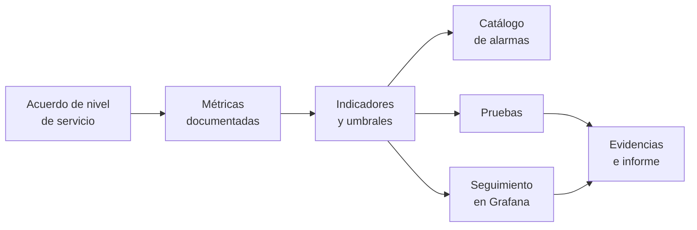

# UD02 · Validación del sistema desplegado

## Resumen del tema

En la UD01 BiciAlacant quedó **observado**: Prometheus recoge sus métricas y Alertmanager clasifica sus alarmas. Ahora toca **validarlo**: demostrar con datos que el sistema cumple lo que se pactó con el cliente. Para ello hay que saber qué significa cada contador que publica la aplicación, convertir esos contadores en **indicadores** con umbrales, documentar cada **alarma** con su procedimiento de resolución y ejecutar **pruebas** (funcionales, de rendimiento, de estrés y de seguridad) cuyos resultados quedan guardados como **evidencias**.



### Objetivos de aprendizaje

- Documentar las métricas de una aplicación y clasificarlas en capacidad, rendimiento y calidad.
- Aplicar los métodos RED y USE para elegir qué medir.
- Traducir un acuerdo de nivel de servicio en SLI, SLO y presupuesto de error.
- Calcular indicadores con PromQL y fijar umbrales de aviso y críticos.
- Redactar un catálogo de alarmas con origen, fallo probable y pasos de resolución.
- Diseñar y ejecutar pruebas funcionales, de carga, de estrés y de seguridad, y documentar sus evidencias.
- Seguir la evolución de los indicadores frente a sus umbrales.

---

## 1. Validar no es «comprobar que funciona»

Cuando el equipo de despliegue entregó BiciAlacant, la web se abría y se podía alquilar una bici. Eso es una **comprobación de humo**, no una validación. Validar responde a preguntas medibles:

| Pregunta del cliente | Cómo se responde |
|---|---|
| ¿Está disponible el 99,5 % del tiempo? | Indicador de disponibilidad calculado sobre las peticiones reales, mes a mes |
| ¿Responde rápido? | Percentil 95 de la latencia frente al umbral de 300 ms |
| ¿Aguanta las mañanas de lunes? | Prueba de carga con el tráfico esperado en hora punta |
| ¿Qué pasa si llega el doble? | Prueba de estrés hasta encontrar el punto de rotura |
| ¿Es seguro? | Prueba de seguridad automatizada y revisión de sus hallazgos |
| ¿Cómo lo sabemos? | **Informe de pruebas** con evidencias: órdenes, salidas, paneles y registros |

> [!IMPORTANT]
> Una validación sin evidencias no existe. Todo lo que afirmes en el informe («la latencia p95 fue de 120 ms») tiene que poder comprobarlo otra persona con el fichero, la captura o la consulta que adjuntas.



## 2. Documentar las métricas de una aplicación



Antes de calcular nada hay que saber **qué cuenta cada contador**. Una métrica mal entendida produce un indicador falso. Por cada métrica se documenta: nombre, tipo, etiquetas, unidad, qué la incrementa o modifica y a qué familia de indicadores pertenece.

Las métricas se agrupan en tres familias, y el criterio de evaluación RA2.a exige que el catálogo tenga **de las tres**:

| Familia | Responde a | Ejemplos |
|---|---|---|
| **Capacidad** | ¿Cuánto puede atender y cuánto le queda? | CPU y memoria frente a sus límites, réplicas disponibles, bicis libres, conexiones a la base de datos |
| **Rendimiento** | ¿Cómo de rápido y cuánto trabajo hace? | Peticiones por segundo, latencia (percentiles), duración de las consultas |
| **Calidad** | ¿Lo hace bien? | Porcentaje de errores 5xx, alquileres fallidos, reinicios, dependencias caídas |

### 2.1 Catálogo de métricas de BiciAlacant

La API 1.1.0 publica estas métricas propias (las verás en `/metrics`):

| Métrica | Tipo | Etiquetas | Qué mide | Familia |
|---|---|---|---|---|
| `bicialacant_peticiones_total` | counter | `metodo`, `ruta`, `codigo` | Peticiones atendidas; `ruta` es la plantilla (`/api/alquiler/<int:id_estacion>`), no la URL | Rendimiento (tasa) · Calidad (códigos 5xx) |
| `bicialacant_duracion_peticion_segundos` | histogram | `ruta`, `le` | Tiempo de respuesta, en cubos de 10 ms a 5 s; genera `_bucket`, `_sum` y `_count` | Rendimiento |
| `bicialacant_alquileres_total` | counter | `resultado` (`ok`, `sin_bicis`) | Intentos de alquiler y su resultado | Calidad (negocio) |
| `bicialacant_bicis_libres` | gauge | `estacion` | Bicis libres en la última lectura de cada estación | Capacidad (negocio) |
| `bicialacant_dependencia_activa` | gauge | `dependencia` (`db`, `cache`) | 1 si respondió en la última comprobación de salud | Calidad |
| `bicialacant_build_info` | info (gauge = 1) | `version` | Versión desplegada | Inventario |

Y de la plataforma, sin tocar la aplicación:

| Métrica | Exportador | Qué mide | Familia |
|---|---|---|---|
| `container_cpu_usage_seconds_total` | cAdvisor (kubelet) | Segundos de CPU consumidos por el contenedor | Capacidad |
| `container_memory_working_set_bytes` | cAdvisor | Memoria en uso que el núcleo no puede liberar (la que cuenta para el `OOMKilled`) | Capacidad |
| `kube_pod_container_resource_limits` | kube-state-metrics | Límites de CPU y memoria declarados | Capacidad |
| `kube_deployment_status_replicas_available` | kube-state-metrics | Réplicas listas de cada Deployment | Capacidad |
| `kube_pod_container_status_restarts_total` | kube-state-metrics | Reinicios de cada contenedor | Calidad |
| `node_filesystem_avail_bytes` | node-exporter | Espacio libre en los discos de los nodos | Capacidad |

> [!TIP]
> El texto `# HELP` de cada métrica es su primera documentación. Si una aplicación publica métricas sin `HELP`, o con un `HELP` que no explica la unidad, anótalo como incidencia para el equipo de desarrollo.

### 2.2 Qué elegir: métodos RED y USE

Con cientos de métricas disponibles, hay dos reglas sencillas para no perderse:

- **RED** (para **servicios**, lo que ve el usuario): *Rate* (peticiones por segundo), *Errors* (peticiones con error), *Duration* (tiempo de respuesta). Se aplica a `web` y `api`.
- **USE** (para **recursos**, lo que hay debajo): *Utilization* (porcentaje de uso), *Saturation* (trabajo en cola o limitado) y *Errors*. Se aplica a CPU, memoria, disco y red de nodos y contenedores.

| | Rate / Utilization | Errors | Duration / Saturation |
|---|---|---|---|
| **API (RED)** | `rate(bicialacant_peticiones_total[5m])` | Peticiones con `codigo=~"5.."` | Percentiles del histograma |
| **Contenedor API (USE)** | CPU usada / límite de CPU | Reinicios, `OOMKilled` | `container_cpu_cfs_throttled_periods_total`: veces que el contenedor quiso más CPU de la permitida |

## 3. Del acuerdo de nivel de servicio a los indicadores

El cliente no habla de contadores, habla de compromisos. Hay tres términos que conviene no mezclar:

| Término | Qué es | En BiciAlacant |
|---|---|---|
| **SLA** (*Service Level Agreement*) | Compromiso contractual, con consecuencias si no se cumple | «Disponibilidad mensual ≥ 99,5 %» |
| **SLO** (*Service Level Objective*) | Objetivo interno que el equipo vigila, igual o más exigente que el SLA | 99,5 % de peticiones sin error 5xx en 30 días |
| **SLI** (*Service Level Indicator*) | La medida concreta con la que se comprueba el SLO | Peticiones no 5xx / peticiones totales |

### 3.1 Presupuesto de error

Si el objetivo es el 99,5 %, el 0,5 % restante es el **presupuesto de error**: lo que se puede «gastar» en fallos, despliegues o mantenimientos sin incumplir.

| Objetivo | Presupuesto | Equivale en 30 días a… |
|---|---|---|
| 99 % | 1 % | 7 h 12 min |
| **99,5 %** | **0,5 %** | **3 h 36 min** |
| 99,9 % | 0,1 % | 43 min |
| 99,99 % | 0,01 % | 4 min 19 s |

El presupuesto cambia decisiones de operación: si a mitad de mes ya se ha gastado el 80 %, se aplazan las actualizaciones arriesgadas (UD04) hasta el mes siguiente.

### 3.2 La tasa de consumo (*burn rate*)

Avisar cuando el SLI baja del 99,5 % en 5 minutos genera demasiadas alarmas; avisar a fin de mes es demasiado tarde. Se vigila la **velocidad** a la que se gasta el presupuesto:

```text
tasa de consumo = ratio de errores observado / ratio de errores permitido (0,005)
```

Una tasa de 1 gasta el presupuesto justo en 30 días. Una tasa de **14,4** lo gasta en 2 días (el 2 % del presupuesto en una hora): hay que actuar ya. La práctica habitual combina dos ventanas para que la alarma salte rápido y se apague en cuanto el problema se corrige:

| Alarma | Condición | Criticidad |
|---|---|---|
| Consumo rápido | tasa > 14,4 en **1 h** y en **5 min** (errores > 7,2 %) | crítica |
| Consumo lento | tasa > 6 en **6 h** y en **30 min** (errores > 3 %) | aviso |

## 4. Indicadores con PromQL

Un **indicador** es una fórmula sobre los contadores que da un número interpretable, con un **umbral** que dice cuándo preocuparse. En la UD01 ya creaste los primeros con reglas de grabación (`bicialacant:errores:ratio5m`, `bicialacant:latencia:p95_5m`). En esta unidad se completan para cubrir las tres familias.

| Indicador | Fórmula (resumida) | Familia | Aviso | Crítico | Origen del umbral |
|---|---|---|---|---|---|
| Disponibilidad (SLI) | `sum(rate(peticiones{codigo!~"5.."}[5m])) / sum(rate(peticiones[5m]))` | Calidad | < 99,5 % | consumo rápido del presupuesto | SLA punto 1 |
| Ratio de errores | `1 - disponibilidad` | Calidad | > 1 % | > 5 % | SLA punto 3 |
| Latencia p95 | `histogram_quantile(0.95, …bucket…)` | Rendimiento | > 300 ms | > 1 s | SLA punto 2 |
| Peticiones rápidas (SLI de latencia) | `sum(rate(…_bucket{le="0.3"}[5m])) / sum(rate(…_count[5m]))` | Rendimiento | < 95 % | < 90 % | SLA punto 2 |
| Tasa de peticiones | `sum(rate(peticiones[5m]))` | Rendimiento | — (informativo) | — | Línea base de la prueba de carga |
| Uso de CPU de la API | CPU usada / límite de CPU | Capacidad | > 70 % | > 90 % | Política interna |
| Uso de memoria de la API | *working set* / límite de memoria | Capacidad | > 80 % | > 95 % | Política interna (riesgo de `OOMKilled`) |
| Réplicas disponibles | `kube_deployment_status_replicas_available{deployment="api"}` | Capacidad | < 2 | 0 | Diseño (mínimo del HPA y del PodDisruptionBudget: 2) |
| Reinicios en 1 h | `increase(kube_pod_container_status_restarts_total[1h])` | Calidad | ≥ 1 | ≥ 3 | Política interna |

### 4.1 Dos formas de medir la latencia

- **Percentil 95** (`histogram_quantile`): «el 95 % de las peticiones tardó menos de X». Fácil de leer, pero es una **estimación** a partir de los cubos: si el umbral no coincide con el borde de un cubo, el valor se interpola.
- **Proporción por debajo del umbral** (`le="0.3"`): «el N % de las peticiones tardó menos de 300 ms». Es **exacto** porque 0,3 es un borde de cubo, y por eso es el SLI que se usa para el SLO.

> [!WARNING]
> Nunca hagas la media de percentiles (`avg(histogram_quantile(...))` por Pod): el resultado no es el percentil del total. Suma primero los cubos de todas las réplicas (`sum by (le)`) y calcula el percentil después.

### 4.2 Umbrales: de dónde salen

Un umbral **no se inventa**. Cada umbral de la tabla indica su origen, y hay tres posibles:

1. **Contrato o documentación** del cliente o del fabricante (SLA, límites del producto).
2. **Diseño**: lo que el sistema necesita para funcionar (3 réplicas, límites de recursos).
3. **Línea base**: lo que el sistema hace en condiciones normales, medido en una prueba de carga. Un umbral «tasa de peticiones < 20 % de lo habitual» solo tiene sentido si sabes qué es lo habitual.

Se usan **dos niveles**: el **aviso** da tiempo a reaccionar durante el horario normal; el **crítico** exige actuar ya.

## 5. Catálogo de alarmas

Una alarma que llega a las tres de la madrugada a alguien que no la conoce tiene que explicarse sola. El **catálogo de alarmas** documenta cada una con una ficha:

| Campo | Contenido |
|---|---|
| **Nombre y criticidad** | `BiciAlacantErroresAltos` · aviso |
| **Condición** | La expresión y su duración (`for`) |
| **Origen** | Componente y métrica que la generan |
| **Qué significa** | Qué ve el usuario cuando salta |
| **Fallo probable** | Las causas más frecuentes, de más a menos probable |
| **Análisis** | Órdenes y consultas para confirmar la causa, en orden |
| **Resolución** | Qué hacer en cada caso y cómo comprobar que se ha resuelto |
| **Escalado** | A quién avisar si no se resuelve (por ejemplo, el equipo de desarrollo) |

Ejemplo:

> **BiciAlacantDependenciaCaida** · crítica · disponibilidad
>
> - **Condición:** `bicialacant_dependencia_activa == 0` durante 1 min.
> - **Origen:** comprobación de salud de la API (`/api/salud`); etiqueta `dependencia` = `db` o `cache`.
> - **Qué significa:** con `db`, no se listan estaciones ni se alquila; la API responde 503 en `/api/salud` y los Pods dejan de estar *Ready*. Con `cache`, solo falla el contador de visitas.
> - **Fallo probable:** 1) el Pod de la dependencia se ha reiniciado o no está listo; 2) una política de red nueva bloquea el puerto; 3) la contraseña del secreto no coincide; 4) el volumen está lleno (solo `db`).
> - **Análisis:** `kubectl -n bicialacant get pods -l app=db` · `kubectl -n bicialacant logs deploy/api | grep SALUD` · `kubectl -n bicialacant get networkpolicy` · `kubectl -n bicialacant exec deploy/db -- df -h /var/lib/postgresql/data`.
> - **Resolución:** según la causa: esperar a que termine el reinicio y revisar por qué ocurrió; revertir la política; corregir el secreto y reiniciar la API; ampliar el volumen. Se da por resuelta cuando la alarma pasa a *resolved* y `/api/salud` devuelve 200.
> - **Escalado:** si la base de datos no arranca tras 15 min, avisar a la responsable del servicio y preparar la restauración desde copia (UD04).

## 6. Tipos de prueba

| Prueba | Pregunta | Herramienta en el laboratorio | Criterio de éxito |
|---|---|---|---|
| **Funcional** (de humo y de regresión) | ¿Cada función hace lo que debe? | `curl` en un script | Todos los códigos y respuestas esperados |
| **Carga** | ¿Cumple los umbrales con el tráfico esperado? | k6 | Umbrales del SLA durante toda la prueba |
| **Estrés** | ¿Dónde se rompe y cómo se recupera? | k6 (tráfico creciente) | Se identifica el punto de rotura y el sistema se recupera sin intervención |
| **Picos** (*spike*) | ¿Aguanta un salto brusco? | k6 | Errores puntuales aceptables, sin caídas |
| **Resistencia** (*soak*) | ¿Se degrada con las horas? | k6 durante horas | Memoria y latencia estables |
| **Seguridad** | ¿Expone vulnerabilidades conocidas? | OWASP ZAP (*baseline*) | Sin alertas altas; las medias justificadas o corregidas |

### 6.1 Pruebas de rendimiento con k6

**k6** es una herramienta de pruebas de carga que se programa en JavaScript. Sus conceptos básicos:

- **VU** (*virtual user*): un usuario simulado que repite la función por defecto en bucle.
- **Escenario**: cómo evoluciona la carga. Por usuarios (`ramping-vus`) o por **peticiones por segundo** (`ramping-arrival-rate`), que es lo que conviene para comparar con el SLA.
- **Checks**: comprobaciones de cada respuesta (código, contenido). No paran la prueba; se cuentan.
- **Thresholds**: los umbrales de la prueba. Si alguno no se cumple, k6 termina con código de salida distinto de 0: la prueba **falla** y se puede usar en un *pipeline*.

```javascript
import http from 'k6/http';
import { check } from 'k6';

export const options = {
  hosts: { 'bicialacant.local': '127.0.0.1' },
  scenarios: {
    hora_punta: {
      executor: 'constant-arrival-rate',
      rate: 30, timeUnit: '1s',          // 30 peticiones por segundo
      duration: '5m', preAllocatedVUs: 20, maxVUs: 100,
    },
  },
  thresholds: {
    http_req_failed: ['rate<0.01'],                 // SLA punto 3
    'http_req_duration{tipo:api}': ['p(95)<300'],   // SLA punto 2
    checks: ['rate>0.99'],
  },
};

export default function () {
  const r = http.get('http://bicialacant.local/api/estaciones', { tags: { tipo: 'api' } });
  check(r, { 'código 200': (x) => x.status === 200 });
}
```

> [!IMPORTANT]
> k6 mide desde **fuera** (lo que ve el cliente, incluida la red y Traefik); Prometheus mide desde **dentro** de la API. Las dos cifras no coinciden exactamente y las dos son útiles: si k6 ve 400 ms y la API 50 ms, el tiempo se pierde antes de llegar a la API.

### 6.2 Pruebas de estrés y punto de rotura



En la prueba de estrés el tráfico **sube por escalones** hasta que algún indicador cruza su umbral crítico. Se anotan tres cosas:

1. **Punto de rotura**: la tasa de peticiones a la que se incumple el SLA.
2. **Cuello de botella**: el recurso que se agota primero (CPU de la API, conexiones a la base de datos, Traefik…), visto en los indicadores USE.
3. **Recuperación**: al bajar la carga, ¿vuelve todo a la normalidad solo? ¿Cuánto tarda? ¿Ha actuado el autoescalado (HPA)?

### 6.3 Pruebas de seguridad con OWASP ZAP

**ZAP** es un escáner de seguridad de aplicaciones web. Su modo ***baseline*** recorre la web y analiza las respuestas **sin atacarla** (cabeceras de seguridad, cookies, información expuesta, versiones), por lo que se puede lanzar contra producción. Clasifica los hallazgos en *High*, *Medium*, *Low* e *Informational*, y termina con un código: 0 sin avisos, 1 con fallos, 2 solo con avisos.

> [!WARNING]
> Solo se escanean sistemas propios o con **autorización por escrito**. El modo activo de ZAP (*full scan*) sí lanza ataques y nunca se usa contra producción.

Cada hallazgo se trata como una incidencia: se reproduce, se evalúa si aplica, se corrige (por ejemplo, añadiendo cabeceras en `nginx.conf`) o se documenta por qué se acepta el riesgo.

## 7. Evidencias e informe de pruebas

Una **evidencia** es cualquier cosa que demuestra un resultado: la salida completa de una orden, el resumen JSON de k6, el informe HTML de ZAP, una captura de un panel con la hora visible, un fragmento de registro. Reglas:

- **Texto mejor que imagen**: `orden > evidencias/fichero.txt 2>&1` se puede buscar y comparar.
- **Con contexto**: fecha y hora, versión de la aplicación (`/api/info`), quién la ejecutó.
- **Nombres consistentes**: `AAAA-MM-DD_prueba_resultado.ext`, por ejemplo `2027-01-15_carga-30rps_OK.json`.
- **Junto a los indicadores y registros del mismo intervalo**: si una prueba falla, el informe muestra qué decía Prometheus y qué escribían los registros en ese momento.

El **informe de pruebas** recoge, para cada prueba: objetivo, entorno y versión, procedimiento (o el script), criterios de éxito, resultado (**pasa / no pasa**), evidencias y, si no pasa, la incidencia abierta y su seguimiento.

## 8. Seguir los indicadores en el tiempo

La validación no termina con el informe: los indicadores se **vigilan** para comprobar que el rendimiento no se sale de los umbrales (RA2.f). En Grafana:

- Un panel por indicador con sus **umbrales dibujados** (*Thresholds* en modo línea o zona): verde, amarillo (aviso) y rojo (crítico).
- Un panel *Stat* con el **presupuesto de error restante** del mes.
- **Anotaciones** con las pruebas y los cambios de versión, para ver su efecto en las gráficas.
- Rangos largos (7 o 30 días) para ver **tendencias**: una latencia que sube 10 ms cada semana anuncia un problema antes de que salte la alarma.

## 9. Errores frecuentes

| Error | Consecuencia | Solución |
|---|---|---|
| Documentar la métrica por su nombre sin probarla | Indicadores que miden otra cosa | Provocar el evento (petición, error) y ver cómo cambia el valor |
| Media de percentiles por Pod | p95 falso | `sum by (le)` antes de `histogram_quantile` |
| Umbrales sin origen | Alarmas que nadie entiende ni respeta | Indicar contrato, diseño o línea base |
| Prueba de carga desde la misma máquina saturada | Se mide el límite del generador, no del sistema | Vigilar la CPU del generador; repartir la carga |
| Contar los 409 de «sin bicis» como errores | La prueba «falla» sin motivo | Declarar las respuestas esperadas (`expectedStatuses`) |
| Prueba de estrés sin plan de vuelta atrás | Producción caída tras la prueba | Instantánea previa, ventana acordada y criterio de parada |
| Escanear con ZAP en modo activo | Datos alterados o servicio caído | Solo *baseline* contra producción |
| Capturas sin hora ni orden | Evidencias que no demuestran nada | Texto con fecha, versión y orden |

## 10. Resumen

- **Validar** es demostrar con datos que el sistema cumple el acuerdo de nivel de servicio.
- Cada métrica se **documenta** (tipo, etiquetas, qué cuenta) y se clasifica en **capacidad, rendimiento y calidad**.
- **RED** para servicios y **USE** para recursos ayudan a elegir qué medir.
- **SLA → SLO → SLI**: el SLI se calcula con PromQL; el **presupuesto de error** y su **tasa de consumo** deciden cuándo avisar.
- Cada indicador tiene **umbral de aviso y crítico** con su origen.
- El **catálogo de alarmas** explica cada una: origen, fallo probable, análisis, resolución y escalado.
- Pruebas **funcionales, de carga, de estrés y de seguridad**, con criterios de éxito definidos antes de ejecutarlas.
- Los resultados se guardan como **evidencias** y se resumen en el **informe de pruebas**.

## 11. Autoevaluación


- q: "¿A qué familia pertenece el indicador «memoria usada / límite de memoria» del contenedor de la API?"
  options: ["Calidad", "Rendimiento", "Capacidad", "Seguridad"]
  answer: 2
  explain: "Dice cuánto margen queda antes de agotar un recurso: es capacidad."
- q: "El método RED se aplica a…"
  options: ["Los discos de los nodos", "Los servicios que atienden peticiones, como la API", "Las copias de seguridad", "Las políticas de red"]
  answer: 1
  explain: "RED (Rate, Errors, Duration) describe lo que ve quien usa un servicio. Para los recursos se usa USE."
- q: "Con un SLO del 99,5 % mensual, ¿cuánto tiempo de fallo total permite el presupuesto de error en 30 días?"
  options: ["43 minutos", "3 h 36 min", "7 h 12 min", "36 horas"]
  answer: 1
  explain: "0,5 % de 720 horas = 3,6 horas."
- q: "¿Por qué el SLI de latencia se calcula con el cubo `le=\"0.3\"` y no con el percentil 95?"
  options: ["Porque es más rápido de calcular", "Porque 0,3 s es un borde de cubo y la proporción es exacta; el percentil es una interpolación", "Porque el percentil no funciona con histogramas", "Porque Grafana no admite percentiles"]
  answer: 1
  explain: "`histogram_quantile` estima el valor dentro del cubo; la proporción por debajo de un borde se cuenta exactamente."
- q: "Una prueba de k6 termina con código de salida 99. ¿Qué indica?"
  options: ["Que el script tiene un error de sintaxis", "Que no se ha cumplido algún *threshold*", "Que la prueba ha ido bien", "Que faltan usuarios virtuales"]
  answer: 1
  explain: "k6 devuelve 99 cuando algún umbral falla; así un *pipeline* puede detener un despliegue."
- q: "En la prueba de estrés, el p95 se dispara a 40 peticiones/s y la CPU de la API está al 100 % de su límite. ¿Qué has encontrado?"
  options: ["Un fallo de la base de datos", "El punto de rotura y su cuello de botella", "Una vulnerabilidad", "Un error del generador de carga"]
  answer: 1
  explain: "El punto de rotura es la carga a la que se incumple el SLA; el recurso agotado (CPU de la API) es el cuello de botella."
- q: "¿Qué modo de OWASP ZAP se puede lanzar contra producción?"
  options: ["Full scan", "Baseline", "API scan con ataques activos", "Ninguno"]
  answer: 1
  explain: "El *baseline* solo observa las respuestas; no envía ataques."
- q: "¿Cuál de estas es una buena evidencia de una prueba funcional?"
  options: ["Una captura del navegador con la web abierta", "La frase «funciona» en el informe", "El fichero con la salida del script, con fecha, versión de la API y códigos de cada petición", "Un vídeo sin sonido"]
  answer: 2
  explain: "La evidencia tiene que poder revisarse y reproducirse: texto con contexto."


## Referencias

- Google SRE Book, cap. 4 *Service Level Objectives* y cap. 6 *Monitoring Distributed Systems* — <https://sre.google/sre-book/table-of-contents/>
- Google SRE Workbook, *Alerting on SLOs* (tasa de consumo y ventanas múltiples) — <https://sre.google/workbook/alerting-on-slos/>
- Brendan Gregg: *The USE Method* — <https://www.brendangregg.com/usemethod.html>
- Prometheus: *Histograms and summaries* — <https://prometheus.io/docs/practices/histograms/>
- Grafana k6: documentación (escenarios, *checks*, *thresholds*) — <https://grafana.com/docs/k6/latest/>
- OWASP ZAP: *Baseline Scan* — <https://www.zaproxy.org/docs/docker/baseline-scan/>
- Grafana: *Configure thresholds* — <https://grafana.com/docs/grafana/latest/panels-visualizations/configure-thresholds/>
