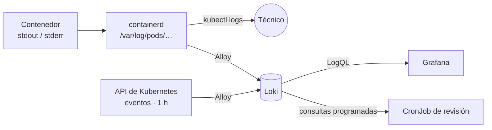

# UD03 · Extracción de datos: registros, accesos y rendimiento

## Resumen del tema

Las alarmas de la UD01 y la UD02 avisan cuando algo cruza un umbral, pero no explican **por qué**. Para eso el técnico de operaciones necesita extraer datos del sistema: leer los **registros** de las aplicaciones, revisar quién intenta **acceder** y con qué resultado, investigar los **reinicios y fallos** de los contenedores y **comparar el rendimiento** de nodos y contenedores. Hacerlo a mano sirve para un caso; hacerlo **de forma periódica y programada** es lo que permite detectar los problemas antes de que lleguen a ser incidencias.



### Objetivos de aprendizaje

- Explicar dónde escriben sus registros los contenedores y cuánto tiempo se conservan.
- Centralizar los registros y los eventos de Kubernetes en Loki y consultarlos con LogQL.
- Programar una revisión periódica de registros, eventos y recursos.
- Detectar intentos de acceso fallidos y ataques de fuerza bruta, y bloquearlos.
- Investigar los reinicios de un contenedor: motivo de terminación, registros previos, eventos y volcados.
- Medir y comparar el uso de CPU, memoria y disco de nodos y contenedores.

---

## 1. Registros en un sistema de contenedores



Una aplicación contenerizada **no escribe ficheros de registro**: escribe en la **salida estándar** (`stdout`) y en la **salida de error** (`stderr`). El entorno de ejecución (containerd en Kubernetes, Docker en Compose) guarda esas líneas en el nodo, y desde ahí se leen con `kubectl logs`.



| Dónde | Qué hay | Cuánto dura |
|---|---|---|
| Ficheros del nodo (`/var/log/pods/`) | Líneas del contenedor actual y del **anterior** | Se **rotan** al llegar a un tamaño (10 MiB por defecto en el kubelet) y se borran con el Pod |
| `kubectl logs --previous` | Registro del contenedor **anterior** al último reinicio | Hasta el siguiente reinicio |
| Eventos de Kubernetes | `Scheduled`, `Pulled`, `BackOff`, `Unhealthy`, `OOMKilling`… | **1 hora** (por defecto en el servidor de la API) |
| Loki | Todo lo anterior, centralizado y con etiquetas | Lo que diga su retención (7 días en el laboratorio) |

> [!IMPORTANT]
> Si un Pod se borra o se reprograma en otro nodo, **sus registros desaparecen** con él. Y los eventos que explican por qué se reinició caducan en una hora. Por eso un sistema en producción **centraliza** registros y eventos: es la única forma de investigar algo que pasó ayer por la noche.

### 1.1 Órdenes básicas

| Orden | Para qué |
|---|---|
| `kubectl logs deploy/api` | Registro de **una** réplica del Deployment |
| `kubectl logs -l app=api --prefix --since=1h` | Todas las réplicas, con el nombre del Pod delante |
| `kubectl logs api-xxx --previous` | El contenedor anterior al último reinicio (imprescindible tras un *crash*) |
| `kubectl logs api-xxx -f --tail=20` | Seguir en directo desde las 20 últimas líneas |
| `kubectl get events -n bicialacant --sort-by=.lastTimestamp` | Eventos recientes, ordenados |
| `kubectl get events --field-selector type=Warning -A` | Solo avisos, de todo el clúster |

## 2. Centralizar con Loki y Alloy

**Loki** es el «Prometheus de los registros»: guarda líneas de texto con **etiquetas** (`namespace`, `app`, `pod`, `container`) y solo indexa las etiquetas, no el texto. Por eso es barato de operar, pero obliga a pensar bien las etiquetas: pocas y con pocos valores distintos (nunca un identificador de usuario o de petición).

**Grafana Alloy** es el agente que recoge los registros y los envía a Loki. En el laboratorio descubre los Pods a través de la API de Kubernetes, añade las etiquetas, detecta el **nivel** de cada línea (`error`, `warning`…) y envía también los **eventos** de Kubernetes, para que no se pierdan a la hora.

### 2.1 LogQL

Una consulta LogQL empieza siempre por un **selector de flujos** (como en PromQL) y sigue con **filtros**:

```text
{namespace="bicialacant", app="api"}                       todas las líneas de la API
{namespace="bicialacant", app="api"} |= "SALUD"            que contienen «SALUD»
{namespace="bicialacant"} |~ "(?i)error|traceback"         expresión regular, sin distinguir mayúsculas
{namespace="bicialacant", app="api"} != "/api/salud"       que NO contienen el texto (quitar el ruido de las sondas)
{job="eventos"} | logfmt | type="Warning"                  separar campos clave=valor y filtrar por uno
```

Y se convierte en **métrica** con funciones de rango, igual que en Prometheus:

```text
count_over_time({namespace="bicialacant"} |~ "(?i)error" [1h])                       líneas de error por flujo en 1 h
sum by (app) (count_over_time({namespace="bicialacant", nivel="error"} [5m]))        errores por aplicación
sum by (reason) (count_over_time({job="eventos"} | logfmt | type="Warning" [24h]))   avisos por motivo
```

> [!TIP]
> Empieza siempre con el selector más estrecho posible (`namespace` y `app`) y añade los filtros después. Una consulta `{}` sobre todo el clúster y 7 días obliga a Loki a leer todos los datos.

## 3. Revisión periódica: manual y programada

El criterio RA3.a pide observar **periódicamente** los registros. Un técnico no puede leer miles de líneas cada día; lo que hace es **una lista de comprobación** que se repite siempre igual, y **automatizarla** en cuanto funciona:

| Cada… | Qué se revisa | Herramienta |
|---|---|---|
| Día | Líneas de error por aplicación, eventos `Warning`, reinicios, accesos fallidos, picos de CPU y memoria, disco libre | Informe programado (CronJob) por correo |
| Semana | Tendencias: memoria que crece, latencia que sube, disco que se llena; IP bloqueadas | Panel de Grafana con rango de 7 días |
| Al momento | Lo que no puede esperar: un patrón de error concreto o una ráfaga de accesos fallidos | Alerta sobre registros |

Formas de programar la revisión:

- **`CronJob` de Kubernetes**: un Pod que se lanza según un horario (`schedule`, con `timeZone`), consulta Loki y Prometheus por su API HTTP y envía el resultado. Queda dentro del clúster, con sus permisos y su historial de ejecuciones.
- **`cron` o temporizadores de systemd** en la máquina: para lo que vive fuera del clúster (el registro de SSH de `ct-lab`, el estado de fail2ban).
- **Alertas sobre registros**: reglas de Grafana (o del *ruler* de Loki) que evalúan una consulta LogQL de métrica y avisan si supera un umbral.

Lo que se encuentra se **reporta**: el informe dice qué se ha revisado, qué está bien y qué hay que mirar; cada problema real se convierte en una incidencia con su seguimiento.

## 4. Accesos al sistema



Un sistema de contenedores tiene varias **puertas** con autenticación, y en todas hay que vigilar los fallos:

| Puerta | Dónde queda el registro | Ejemplo de línea de fallo |
|---|---|---|
| SSH a las máquinas (`ct-lab`) | journald del sistema (`journalctl -u ssh`) | `Failed password for invalid user admin from 192.168.56.20 port 51234 ssh2` |
| Interfaz web con usuario (Grafana) | Registro del contenedor → Loki | Mensaje de *login* fallido con el usuario y la IP de origen |
| API de Kubernetes | Registro de auditoría del servidor de la API (si está activado) | Respuestas 401/403 |

### 4.1 Fuerza bruta: detectar y bloquear



Un ataque de fuerza bruta se reconoce por **muchos fallos desde el mismo origen en poco tiempo**. La respuesta tiene dos partes:

1. **Bloquear** automáticamente: **fail2ban** lee los registros, cuenta los fallos por IP en una ventana (`findtime`) y, al superar `maxretry`, añade una regla de cortafuegos que bloquea esa IP durante `bantime`. Grafana bloquea por su cuenta un usuario tras varios fallos seguidos.
2. **Avisar y registrar**: una alerta sobre los registros avisa de la ráfaga, y el informe diario cuenta los fallos y las IP bloqueadas.

> [!WARNING]
> Detrás de un proxy inverso (Traefik, nginx), la aplicación ve la IP **del proxy**, no la del cliente. Bloquear esa IP dejaría a todos fuera. La IP real viaja en la cabecera `X-Forwarded-For` y el bloqueo debe hacerse en el proxy o con una herramienta que la lea. Y nunca olvides añadir tu propia IP a la lista de excepciones (`ignoreip`) antes de probar.

## 5. Fallos y reinicios de la aplicación



Cuando un contenedor termina, Kubernetes guarda el **motivo** y el **código de salida** del último final y lo reinicia según `restartPolicy`. Si vuelve a fallar enseguida, espera cada vez más (10 s, 20 s, 40 s… hasta 5 min): es el estado **`CrashLoopBackOff`**.

| Motivo (`Last State`) | Código | Qué significa | Dónde mirar |
|---|---|---|---|
| `Completed` | 0 | El proceso terminó bien (en un servicio, no debería terminar) | Registro previo: ¿por qué salió? |
| `Error` | 1, 2, 3… | La aplicación terminó con error | `kubectl logs --previous`: la traza suele estar al final |
| `OOMKilled` | 137 | Superó su `limits.memory` y el núcleo lo mató | Memoria del contenedor antes del final; límite frente a uso real |
| `Error` | 137 | Recibió `SIGKILL` (por ejemplo, no paró a tiempo tras `SIGTERM`) | Eventos: ¿se reprogramó, falló la sonda de vida? |
| `Error` | 143 | Terminó por `SIGTERM` | Normal en despliegues y bajadas de escala |

Y en los **eventos**: `BackOff` (reinicio con espera), `Unhealthy` (sonda fallida), `Killing` (Kubernetes lo detiene, por ejemplo por la sonda de vida), `FailedScheduling` (no cabe en ningún nodo), `Evicted` (el nodo se quedó sin recursos).

### 5.1 Procedimiento de diagnóstico

```text
1. kubectl get pods                         ¿RESTARTS > 0? ¿CrashLoopBackOff?
2. kubectl describe pod <pod>               Last State: motivo, código, hora; Events al final
3. kubectl logs <pod> --previous            ¿qué escribió antes de morir?
4. Loki: registros y eventos de ese Pod     ¿qué pasaba antes? ¿desde cuándo ocurre?
5. Prometheus: memoria, CPU, reinicios      ¿se acercaba al límite? ¿coincide con carga?
6. Corregir la CAUSA, no el síntoma         límites, configuración, versión… y comprobar
```

### 5.2 Volcados: ver qué hacía el proceso



Un **volcado** (*dump*) es una fotografía del proceso: un volcado de memoria completo (*core dump*), o la **pila de llamadas** de cada hilo, que dice en qué línea de código estaba. En contenedores:

- Los *core dumps* los controla el **núcleo del nodo** (`/proc/sys/kernel/core_pattern`), no el contenedor; en Kubernetes casi nunca están disponibles y pueden contener datos personales, así que se tratan como información sensible.
- Lo habitual es pedir a la aplicación que **vuelque su estado** (en Python, el módulo `faulthandler` escribe la pila en `stderr` al fallar) o inspeccionar el proceso en vivo con un **contenedor efímero de depuración**:

```bash
kubectl debug -it api-xxx --image=python:3.13-slim --target=api --profile=sysadmin -- bash
```

`--target` comparte el espacio de procesos con el contenedor `api`, así que desde el contenedor de depuración se ven sus procesos (`/proc/1/…`) con herramientas que la imagen de producción no tiene, como **py-spy**, que vuelca la pila de un proceso Python sin detenerlo. El contenedor efímero desaparece con el Pod, sin modificar la imagen.

## 6. Rendimiento de nodos y contenedores



El criterio RA3.d pide **evaluar y comparar** el uso de CPU, memoria y disco. Las fuentes son las mismas de la UD02, ahora mirando la máquina:

| Recurso | Nodo (node-exporter) | Contenedor (cAdvisor) | Al momento |
|---|---|---|---|
| CPU | `1 - avg by (instance) (rate(node_cpu_seconds_total{mode="idle"}[5m]))` | `rate(container_cpu_usage_seconds_total[5m])` · `container_cpu_cfs_throttled_periods_total` | `kubectl top nodes` / `kubectl top pods` |
| Memoria | `1 - node_memory_MemAvailable_bytes / node_memory_MemTotal_bytes` | `container_memory_working_set_bytes` | `kubectl top` |
| Disco (espacio) | `node_filesystem_avail_bytes / node_filesystem_size_bytes` | `kubelet_volume_stats_available_bytes` (volúmenes) | `df -h` dentro del Pod |
| Disco (actividad) | `rate(node_disk_io_time_seconds_total[5m])` (fracción del tiempo ocupado) | `rate(container_fs_writes_bytes_total[5m])` | `iostat` en el nodo |
| Red | `rate(node_network_receive_bytes_total[5m])` | `rate(container_network_receive_bytes_total[5m])` | — |

Para **comparar** hay que fijar las condiciones: misma carga (el `carga.js` de la UD02), misma duración, y medir **antes y después** de un cambio (más CPU, menos réplicas, otra versión). Una comparación sin la misma carga no demuestra nada.

> [!NOTE]
> En kind, los «nodos» son contenedores de Docker que comparten el núcleo y el disco de `ct-lab`. Los valores de node-exporter son los de `ct-lab` vistos desde cada nodo: compara contenedores entre sí y con sus límites, y usa los nodos para la tendencia general.

## 7. Errores frecuentes

| Error | Consecuencia | Solución |
|---|---|---|
| Investigar un reinicio con `kubectl logs` sin `--previous` | Se lee el registro del contenedor nuevo, que no sabe nada del fallo | `--previous` |
| Buscar los eventos de anoche con `kubectl get events` | Ya han caducado | Enviar los eventos a Loki |
| Etiqueta de Loki con valores únicos (IP, id de petición) | Loki se vuelve lento y caro | Dejarlo en el texto y filtrar con `\|=` o `\| logfmt` |
| Registro lleno de líneas de las sondas de salud | El error real se pierde | Filtrar `!= "/api/salud"` |
| fail2ban bloquea al profesor o a tu propio equipo | Te quedas sin acceso | `ignoreip` antes de activar la jaula |
| Subir el límite de memoria tras un `OOMKilled` sin mirar la tendencia | Si es una fuga, solo se retrasa el fallo | Comprobar si la memoria crece sin parar antes de ampliar |
| Revisión «periódica» que nadie lee | Es como no tenerla | Informe corto, con estado al principio y solo lo que hay que mirar |

## 8. Resumen

- Los contenedores escriben en **stdout/stderr**; sus registros se rotan y desaparecen con el Pod; los eventos duran **1 hora**.
- **Loki + Alloy** centralizan registros y eventos con etiquetas; **LogQL** filtra texto y lo convierte en métricas.
- La revisión **periódica** es una lista de comprobación fija, **automatizada** con un CronJob y complementada con alertas sobre registros.
- Los accesos fallidos se **detectan** en los registros, se **bloquean** con fail2ban (o el propio servicio) y se **reportan**.
- Un reinicio se investiga con el **motivo y código** de terminación, `--previous`, los eventos y las métricas; un volcado de la pila dice qué hacía el proceso.
- El rendimiento se **compara** con la misma carga, antes y después de un cambio.

## 9. Autoevaluación


- q: "La API se reinició esta madrugada. ¿Qué orden muestra lo que escribió antes de morir?"
  options: ["`kubectl logs api-xxx`", "`kubectl logs api-xxx --previous`", "`kubectl get events`", "`kubectl describe deploy api`"]
  answer: 1
  explain: "Sin `--previous` se lee el contenedor actual, que arrancó después del fallo."
- q: "¿Por qué se envían los eventos de Kubernetes a Loki?"
  options: ["Porque `kubectl` no puede leerlos", "Porque el servidor de la API solo los conserva una hora", "Porque ocupan mucho", "Para cifrarlos"]
  answer: 1
  explain: "Pasada una hora desaparecen; en Loki se conservan lo que diga su retención."
- q: "¿Cuál es una mala etiqueta para Loki?"
  options: ["`namespace`", "`app`", "La IP del cliente", "`container`"]
  answer: 2
  explain: "Tiene muchísimos valores distintos: cada uno crea un flujo nuevo. Se deja en el texto de la línea."
- q: "¿Qué consulta cuenta las líneas de error de cada aplicación de BiciAlacant en la última hora?"
  options: ["`{namespace=\"bicialacant\"} |= \"error\"`", "`sum by (app) (count_over_time({namespace=\"bicialacant\"} |~ \"(?i)error\" [1h]))`", "`rate(bicialacant_peticiones_total[1h])`", "`count({namespace=\"bicialacant\"})`"]
  answer: 1
  explain: "La primera devuelve líneas, no un número; `count_over_time` las cuenta y `sum by (app)` agrupa."
- q: "Un contenedor aparece con `Last State: Terminated, Reason: OOMKilled, Exit Code: 137`. ¿Qué ha pasado?"
  options: ["Ha fallado la sonda de vida", "Ha superado su límite de memoria y el núcleo lo ha matado", "Se ha desplegado una versión nueva", "La imagen no existe"]
  answer: 1
  explain: "137 = 128 + 9 (SIGKILL); con el motivo `OOMKilled`, la causa es la memoria."
- q: "fail2ban bloquea una IP cuando…"
  options: ["Recibe una alarma de Alertmanager", "Cuenta más de `maxretry` fallos de esa IP en `findtime`", "La IP no está en el DNS", "El usuario no existe"]
  answer: 1
  explain: "Lee el registro, cuenta los fallos por IP en la ventana y añade una regla de cortafuegos durante `bantime`."
- q: "¿Para qué sirve `--target=api` en `kubectl debug`?"
  options: ["Para reiniciar el contenedor api", "Para que el contenedor de depuración comparta el espacio de procesos del contenedor api", "Para copiar la imagen", "Para depurar el Service api"]
  answer: 1
  explain: "Así se ven y se inspeccionan los procesos de la aplicación con herramientas que su imagen no trae."
- q: "Quieres saber si dar 1 CPU a la API en lugar de 0,5 mejora el rendimiento. ¿Cómo lo compruebas?"
  options: ["Mirando `kubectl top` una vez después del cambio", "Repitiendo la misma prueba de carga antes y después y comparando latencia, limitación de CPU y errores", "Preguntando a los usuarios", "Reiniciando los Pods"]
  answer: 1
  explain: "Solo con la misma carga se puede atribuir la diferencia al cambio."


## Referencias

- Kubernetes: *Logging Architecture* — <https://kubernetes.io/docs/concepts/cluster-administration/logging/>
- Kubernetes: *Debug Running Pods* y *Ephemeral Containers* — <https://kubernetes.io/docs/tasks/debug/debug-application/debug-running-pod/>
- Kubernetes: *Pod Lifecycle* (estados y motivos de terminación) — <https://kubernetes.io/docs/concepts/workloads/pods/pod-lifecycle/>
- Grafana Loki: *LogQL* — <https://grafana.com/docs/loki/latest/query/>
- Grafana Loki: *Labels best practices* — <https://grafana.com/docs/loki/latest/get-started/labels/bp-labels/>
- Grafana Alloy: componentes `loki.source.kubernetes` y `loki.source.kubernetes_events` — <https://grafana.com/docs/alloy/latest/reference/components/>
- fail2ban: manual — <https://github.com/fail2ban/fail2ban/wiki>
- py-spy — <https://github.com/benfred/py-spy>
