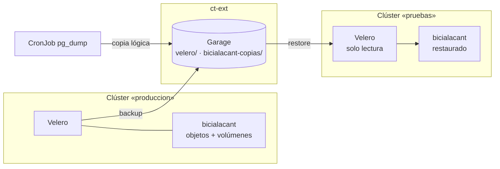

# UD04 · Copias de seguridad y actualizaciones

## Resumen del tema

Mantener un sistema es, sobre todo, **protegerlo de lo que va a pasar**: un disco que falla, un borrado por error, una actualización que sale mal o una vulnerabilidad publicada en una librería que usa la imagen. Para lo primero están las **copias de seguridad**, que solo valen si se **programan**, se **guardan fuera** del sistema y se **restauran** de vez en cuando. Para lo segundo está el **mantenimiento del software**: vigilar versiones y vulnerabilidades, actualizar sin perder datos, saber volver atrás y dejar constancia de cada cambio.



### Objetivos de aprendizaje

- Traducir el RPO y el RTO del acuerdo de servicio en una política de copias.
- Identificar qué hay que copiar en un sistema de contenedores y con qué técnica.
- Programar copias, enviarlas a un medio externo y aplicar rotación y limpieza.
- Comprobar periódicamente que una copia se puede restaurar en una plataforma de pruebas.
- Detectar vulnerabilidades y versiones nuevas de los componentes de una imagen.
- Actualizar en producción sin pérdida de datos, resolver los fallos y volver atrás.
- Documentar cada cambio de versión con trazabilidad.

---

## 1. RPO, RTO y política de copias

El acuerdo de servicio de BiciAlacant dice: «se puede perder como mucho **24 horas** de datos y el servicio se recupera en menos de **1 hora**».

| Término | Pregunta | BiciAlacant | Qué decide |
|---|---|---|---|
| **RPO** (*Recovery Point Objective*) | ¿Cuántos datos puedo perder? | 24 h | La **frecuencia** de las copias: al menos una diaria |
| **RTO** (*Recovery Time Objective*) | ¿Cuánto puedo tardar en volver? | 1 h | La **técnica** y el **procedimiento** de restauración, y que esté **ensayado** |

Una **política de copias** responde por escrito a: qué se copia, cada cuánto, con qué herramienta, dónde se guarda, cuánto tiempo se conserva, quién lo comprueba y cómo se restaura.

### 1.1 La regla 3-2-1

- **3** copias de los datos (el original y dos más).
- en **2** soportes distintos.
- **1** de ellas **fuera** del sistema que protege (otra máquina, otro edificio, otra nube).

En el laboratorio: los datos en el volumen de PostgreSQL, la copia en **Garage** (en `ct-ext`, otra máquina) y, en la ampliación, una segunda copia descargada a tu equipo. Muchas organizaciones añaden un «+1»: una copia **inmutable** (que nadie puede borrar durante un tiempo, ni siquiera con la contraseña del administrador), la única defensa real contra el *ransomware*.

### 1.2 Retención y rotación

No se guardan todas las copias para siempre: ocupan espacio, cuestan dinero y, si contienen datos personales, guardarlas más de lo necesario incumple la normativa de protección de datos. La **retención** dice cuánto se conservan; la **rotación** borra las que la superan.

| Esquema | Ejemplo | Uso |
|---|---|---|
| Simple | Las últimas 14 diarias | Sistemas pequeños como BiciAlacant |
| Abuelo-padre-hijo (GFS) | 7 diarias, 4 semanales, 12 mensuales | Cuando hace falta volver a fechas antiguas |

> [!WARNING]
> La rotación debe dejar siempre un **mínimo** de copias aunque estén caducadas. Si las copias llevan una semana fallando y la rotación borra «todo lo de más de 14 días», acabarás sin ninguna.

## 2. Qué hay que copiar en un sistema de contenedores



Un contenedor se puede recrear desde su imagen: **no se copia**. Lo que no se puede recrear es lo que hay que proteger:

| Qué | Dónde está en BiciAlacant | Cómo se copia |
|---|---|---|
| **Datos** de la aplicación | Volumen de PostgreSQL (`datos-db-0`) | Copia **lógica** (`pg_dump`) y/o copia del volumen (Velero) |
| **Manifiestos** y configuración | Repositorio Git (`k8s/`, `config/`) | Git ya es la copia, si está en un servidor remoto |
| **Secretos** | `Secret` de Kubernetes (`db-cred`) | Gestor de secretos o copia **cifrada**; nunca en Git en claro |
| **Imágenes** propias | Registro de imágenes | El registro con su propia copia, o reconstrucción desde Git con versiones fijas |
| **Estado del clúster** | etcd | En un clúster real, `etcdctl snapshot save`; en kind, se recrea el clúster |
| Datos efímeros | Redis (contador de visitas) | No se copian: se acepta perderlos (decisión documentada) |

### 2.1 Copia lógica frente a copia de volumen

| | Copia lógica (`pg_dump`) | Copia del volumen (Velero con copia de ficheros) |
|---|---|---|
| Qué guarda | El contenido de la base de datos como órdenes o en formato propio | Los ficheros del volumen y los objetos de Kubernetes |
| Consistencia | **Siempre consistente**: `pg_dump` usa una instantánea de la transacción | Hay que parar o congelar la base de datos, o la copia puede no arrancar |
| Restauración | En cualquier PostgreSQL de versión igual o superior, incluso parcial (una tabla) | En un clúster con Velero; restaura el espacio de nombres completo |
| Tamaño | Pequeño y comprimido | Todo el volumen |
| Útil para | Recuperar **datos** | Recuperar el **servicio completo** (objetos + datos) |

En la práctica se combinan: `pg_dump` diario como copia principal de los datos y Velero para poder levantar el espacio de nombres entero en otro clúster.

> [!IMPORTANT]
> Copiar los ficheros de una base de datos **en marcha** produce, a menudo, una copia que no arranca. Por eso las copias de volumen de bases de datos se hacen con *hooks* (`pg_backup_start`/`pg_backup_stop`, o parando la escritura) o se acompañan siempre de una copia lógica.

## 3. Programar y verificar las copias

En Kubernetes, la copia programada es un **`CronJob`**: un Pod que se lanza a una hora fija (`schedule` y `timeZone`), con historial de ejecuciones. Puntos clave:

- `concurrencyPolicy: Forbid`: nunca dos copias a la vez.
- `startingDeadlineSeconds`: si el clúster estaba parado a la hora prevista, se lanza al volver.
- `backoffLimit` y `activeDeadlineSeconds`: reintentos y tiempo máximo.
- Comprobaciones **dentro** del trabajo: que el fichero se puede leer (`pg_restore --list`) y su **suma de comprobación** (`sha256sum`) para detectar corrupción al transferirlo o guardarlo.

**Verificar la ejecución** no es mirar el CronJob de vez en cuando: es una **alarma**. kube-state-metrics publica `kube_cronjob_status_last_successful_time`; si la última copia correcta tiene más de 26 horas, el RPO ya no se cumple y salta `BiciAlacantCopiaAtrasada`.

## 4. El medio externo: almacenamiento de objetos

Las copias se envían a un **almacén de objetos compatible con S3**, el estándar de facto: AWS S3, Google Cloud Storage, Azure (con pasarela) y servidores propios como **Garage**, Ceph o SeaweedFS. Conceptos:

| Concepto | Qué es |
|---|---|
| **Depósito** (*bucket*) | Contenedor de objetos, con sus propios permisos |
| **Objeto** y **clave** | El fichero y su nombre completo (`postgres/2027/01/bicialacant-20270115T021500Z.dump`) |
| **Claves de acceso** | Identificador y secreto; **una por uso** y con acceso solo a su depósito (mínimo privilegio) |
| **Ciclo de vida** (*lifecycle*) | Reglas del propio almacén que borran o mueven objetos al cumplir una edad |
| **Versionado** y **bloqueo** (*object lock*) | Guardar versiones anteriores al sobrescribir y prohibir el borrado durante un tiempo (inmutabilidad) |

> [!NOTE]
> Este módulo usaba MinIO, el servidor S3 libre más conocido, pero en octubre de 2025 su edición comunitaria dejó de publicar imágenes y binarios. Es un buen ejemplo de **riesgo de la cadena de suministro**: una dependencia que deja de mantenerse obliga a cambiar de componente. Por eso aquí se usa **Garage**, y por eso el libro de operaciones debe registrar de dónde sale cada imagen.

## 5. Velero: copia y restauración del clúster

**Velero** copia los **objetos de Kubernetes** (Deployments, Services, Secrets, PVC…) de uno o varios espacios de nombres y, con su **agente de nodo**, el **contenido de los volúmenes** (copia de ficheros con Kopia). Lo guarda todo en un depósito S3 y lo puede restaurar en el mismo clúster o en **otro**.



| Orden | Para qué |
|---|---|
| `velero backup create diaria-1 --include-namespaces bicialacant` | Copia del espacio de nombres |
| `velero schedule create diaria --schedule "30 3 * * *" --include-namespaces bicialacant --ttl 336h` | Copia programada con retención de 14 días |
| `velero backup describe diaria-1 --details` | Qué contiene y si terminó bien |
| `velero restore create --from-backup diaria-1` | Restaurar |

El clúster de pruebas se conecta al depósito en modo **solo lectura** (`accessMode: ReadOnly`): así un error en las pruebas nunca puede borrar las copias de producción.

## 6. Mantenimiento preventivo: la prueba de restauración

> Una copia que no se ha restaurado nunca no es una copia: es una esperanza.

El mantenimiento preventivo de las copias (RA4.c) consiste en **restaurarlas periódicamente** (por ejemplo, una vez al mes) en una **plataforma de pruebas** y comprobar:

1. Que la restauración **termina sin errores** y en un tiempo compatible con el **RTO** (cronométralo).
2. Que el servicio **arranca** y pasa las **pruebas funcionales** de la UD02.
3. Que los **datos son íntegros**: mismo número de filas y misma **huella** (resumen MD5) que en producción en el momento de la copia.
4. Que el procedimiento escrito es **suficiente**: si has tenido que improvisar un paso, el libro de operaciones estaba incompleto.

## 7. Mantener el software: versiones, parches y vulnerabilidades

Una imagen de contenedor es una pila de componentes, y **cada capa envejece**:

| Capa | En la API de BiciAlacant | Cómo se sabe si hay versión nueva |
|---|---|---|
| Sistema base | Debian de `python:3.13-slim` | Etiquetas de la imagen oficial; avisos de seguridad de Debian |
| Intérprete | Python 3.13.x | Notas de versión de Python |
| Librerías | Flask, gunicorn, psycopg, redis, prometheus-client | `pip list --outdated`; páginas de versiones (PyPI, GitHub) |
| Servicios de terceros | `postgres:17-alpine`, `redis:7-alpine`, `nginx-unprivileged` | Etiquetas en el registro; notas de versión |
| Plataforma | Kubernetes, Traefik, kube-prometheus-stack | Notas de versión; `helm search repo --versions` |

### 7.1 Versiones semánticas y etiquetas



`MAYOR.MENOR.PARCHE`: un **parche** corrige errores sin cambiar nada más (17.5 → 17.6 en PostgreSQL); una **menor** añade funciones compatibles; una **mayor** puede romper la compatibilidad (17 → 18 en PostgreSQL exige migrar los datos con `pg_upgrade` o un volcado).

Etiquetas flotantes como `postgres:17-alpine` o `latest` son cómodas, pero **la imagen cambia sin que cambie el manifiesto**: hoy y mañana puedes estar ejecutando cosas distintas. En producción se fija la versión completa (`postgres:17.6-alpine3.22`) o, mejor, el **resumen** (`postgres@sha256:…`), y se actualiza **a propósito**.

### 7.2 Vulnerabilidades: CVE, SBOM y escáneres



- Una **CVE** es una vulnerabilidad publicada con un identificador (`CVE-2025-12345`), una gravedad (puntuación **CVSS**: baja, media, alta, crítica) y, si existe, la versión que la corrige.
- Un **SBOM** (*Software Bill of Materials*) es la lista de todos los componentes y versiones de una imagen.
- Un **escáner** (Trivy, Grype) genera el SBOM y lo cruza con las bases de datos de vulnerabilidades.

```bash
trivy image bicialacant-api:1.1.0                          # todas las vulnerabilidades
trivy image --severity HIGH,CRITICAL --ignore-unfixed bicialacant-api:1.1.0   # solo las graves con solución
trivy image --format cyclonedx -o sbom-api-1.1.0.json bicialacant-api:1.1.0   # SBOM
```

Para cada hallazgo grave: **¿afecta?** (¿se usa ese componente o esa función?), **¿hay solución?** (versión corregida, parche del sistema base), **¿qué dicen los foros y avisos del proyecto?** (GitHub *Security Advisories*, listas de correo, el propio aviso de la CVE) y **qué se hace**: actualizar, mitigar (por ejemplo, desactivar la función afectada) o aceptar el riesgo con justificación y fecha de revisión. El SLA de BiciAlacant da **7 días** para corregir una crítica.

## 8. Actualizar sin perder datos

### 8.1 Antes de actualizar

1. Leer las **notas de versión**: cambios incompatibles, migraciones, pasos especiales.
2. Hacer una **copia** justo antes y anotar la **huella** de los datos.
3. Probar la actualización completa en el clúster de **pruebas** (restaurado desde la copia de producción).
4. Acordar la **ventana**, el **criterio de éxito** y el **plan de vuelta atrás**.

### 8.2 Migraciones del esquema: ampliar y después contraer

Si la versión nueva cambia la base de datos, la migración se diseña para que **la versión antigua siga funcionando** con el esquema nuevo:

1. **Ampliar** (*expand*): solo se **añade** (tablas, columnas con valor por defecto). La API 1.1.0 ignora lo nuevo.
2. **Desplegar** la aplicación nueva. Si falla, se vuelve a la anterior **sin tocar la base de datos**.
3. **Contraer** (*contract*): semanas después, cuando ya no se va a volver atrás, se borra lo que sobra.

Una migración que **borra o renombra** algo de golpe convierte la vuelta atrás en una restauración desde copia, con la pérdida de datos que eso supone.

### 8.3 Estrategias de despliegue y vuelta atrás



| Estrategia | Cómo | Vuelta atrás |
|---|---|---|
| **Actualización progresiva** (*RollingUpdate*) | Kubernetes sustituye las réplicas de una en una; solo continúa si las nuevas están listas | `kubectl rollout undo` |
| **Recreate** | Para todas y arranca las nuevas (corte de servicio) | Volver a la imagen anterior |
| **Azul-verde** | Dos versiones completas; se cambia el tráfico de golpe | Devolver el tráfico |
| **Canario** | Una parte pequeña del tráfico a la nueva versión y se observan los indicadores | Retirar el canario |

Para una base de datos con un solo Pod (StatefulSet), una actualización de **parche** reinicia el Pod con la imagen nueva sobre el **mismo volumen**: hay un corte de segundos y los datos se conservan. Una actualización **mayor** necesita un procedimiento de migración de datos.

### 8.4 Cuando la actualización falla

1. **Detener** el avance (`kubectl rollout pause`) o volver atrás de inmediato si el servicio está afectado.
2. **Recoger los datos** del fallo con lo aprendido en la UD03: eventos, `--previous`, registros, métricas.
3. **Clasificar**: ¿fallo de configuración (lo corrige operación) o del código (se **reporta al equipo de desarrollo** con las evidencias)?
4. **Comprobar** que, tras la corrección o la vuelta atrás, el servicio y los datos están como antes (pruebas funcionales y huella).

## 9. Documentar los cambios: trazabilidad

Cada cambio de versión deja rastro en tres sitios:

- **Registro de cambios** (`CHANGELOG.md`): fecha, componente, versión anterior → nueva, motivo (vulnerabilidad, mejora, corrección), quién, resultado y enlace a las evidencias.
- **Git**: los manifiestos con la versión nueva en un *commit* con mensaje claro y una **etiqueta** (`git tag bicialacant-1.2.0`).
- **Kubernetes**: `kubectl annotate deploy/api kubernetes.io/change-cause="API 1.2.0: registro de alquileres"` hace que `kubectl rollout history` muestre el motivo de cada revisión.

Con los tres, cualquier persona puede responder: ¿qué versión había el día 15?, ¿por qué se cambió?, ¿quién lo hizo?, ¿cómo se comprobó?

## 10. Errores frecuentes

| Error | Consecuencia | Solución |
|---|---|---|
| Copias en el mismo disco o clúster que los datos | Se pierden a la vez | Medio externo (regla 3-2-1) |
| Nadie vigila si la copia termina bien | Se descubre el día que se necesita | Alarma sobre `last_successful_time` |
| Nunca se restaura | La copia está corrupta o incompleta y nadie lo sabe | Prueba de restauración periódica en pruebas |
| Clave de acceso con permisos de administrador del almacén | Quien la robe borra todas las copias | Una clave por uso, solo con su depósito |
| `pg_dump` de versión menor que el servidor | Error al volcar | Imagen del cliente igual o superior |
| Etiquetas flotantes (`:17-alpine`, `latest`) | Cambios de versión no controlados | Versión completa o resumen |
| Migración que borra columnas a la vez que se despliega | No se puede volver atrás sin perder datos | Ampliar y contraer |
| Actualizar sin copia ni huella previa | No se puede demostrar que no se ha perdido nada | Copia + huella antes, huella después |
| Cambiar la imagen pero no la configuración (`APP_VERSION` en el ConfigMap) | El sistema informa de una versión que no es | Revisar todo lo que la versión toca y comprobarlo después |

## 11. Resumen

- El **RPO** fija la frecuencia de las copias y el **RTO** la técnica y el ensayo de la restauración.
- Se copian los **datos**, la **configuración** y los **secretos**; los contenedores se recrean desde sus imágenes.
- **`pg_dump`** para datos consistentes y **Velero** para el espacio de nombres completo.
- Copias **programadas**, **verificadas** con alarmas, en un **medio externo** con **rotación** que conserva un mínimo.
- La copia se **restaura periódicamente** en una plataforma de pruebas y se comprueba la **integridad** con una huella.
- **Trivy** detecta vulnerabilidades; cada hallazgo grave se investiga y se corrige o se justifica.
- Actualizaciones con **copia previa**, **migraciones compatibles**, **despliegue progresivo** y **vuelta atrás** preparada.
- **Registro de cambios + Git + anotaciones** = trazabilidad.

## 12. Autoevaluación


- q: "El SLA dice que se pueden perder como mucho 24 horas de datos. ¿Qué indicador es?"
  options: ["RTO", "RPO", "SLO de latencia", "MTTR"]
  answer: 1
  explain: "El RPO es la cantidad de datos (medida en tiempo) que se puede perder: obliga a copiar al menos cada 24 h."
- q: "¿Qué NO hace falta incluir en la copia de BiciAlacant?"
  options: ["El volumen de PostgreSQL", "El Secret db-cred", "Los contenedores de la API", "Los manifiestos"]
  answer: 2
  explain: "Los contenedores se recrean desde la imagen; lo que no se puede recrear son los datos, los secretos y la configuración."
- q: "¿Por qué la copia principal de la base de datos es `pg_dump` y no la copia de los ficheros del volumen?"
  options: ["Porque es más rápida siempre", "Porque es consistente aunque la base de datos esté en marcha", "Porque Velero no funciona con PostgreSQL", "Porque ocupa más"]
  answer: 1
  explain: "`pg_dump` trabaja sobre una instantánea transaccional; copiar los ficheros en caliente puede dar una copia que no arranca."
- q: "La rotación borra las copias de más de 14 días. ¿Qué protección añade el script de copia?"
  options: ["Cifra las copias", "Conserva siempre un mínimo de copias aunque estén caducadas", "Envía un correo", "Duplica las copias"]
  answer: 1
  explain: "Si las copias fallan durante días, la rotación sin mínimo acabaría dejándote sin ninguna."
- q: "¿Por qué el clúster de pruebas se conecta al depósito de Velero en modo `ReadOnly`?"
  options: ["Porque es más rápido", "Para que un error en pruebas no pueda borrar ni modificar las copias de producción", "Porque Garage lo exige", "Para ahorrar espacio"]
  answer: 1
  explain: "Mínimo privilegio: para restaurar solo hace falta leer."
- q: "Trivy encuentra una CVE crítica en una librería de la API con versión corregida disponible. Según el SLA, ¿qué plazo hay?"
  options: ["Ninguno", "7 días", "30 días", "Hasta la siguiente versión mayor"]
  answer: 1
  explain: "El punto 5 del acuerdo de servicio: ninguna crítica sin corregir más de 7 días."
- q: "¿Qué hace que la vuelta atrás de la API 1.2.0 a la 1.1.0 sea segura?"
  options: ["Que la migración solo añade tablas y la 1.1.0 funciona con el esquema nuevo", "Que se borra la base de datos", "Que se usa la estrategia Recreate", "Que la 1.2.0 no tiene errores"]
  answer: 0
  explain: "Con migraciones de ampliación, la aplicación vuelve atrás sin tocar los datos."
- q: "¿Qué permite responder «por qué se cambió la versión de la API el día 15»?"
  options: ["`kubectl get pods`", "El registro de cambios, el *commit* y la anotación `change-cause` del Deployment", "Los registros de la API", "El panel de Grafana"]
  answer: 1
  explain: "La trazabilidad se construye documentando cada cambio en los tres sitios."


## Referencias

- PostgreSQL: *Backup and Restore* (`pg_dump`, `pg_restore`) — <https://www.postgresql.org/docs/current/backup.html>
- Kubernetes: *CronJob* — <https://kubernetes.io/docs/concepts/workloads/controllers/cron-jobs/>
- Velero: documentación y *File System Backup* — <https://velero.io/docs/>
- Garage: documentación — <https://garagehq.deuxfleurs.fr/documentation/>
- Trivy — <https://trivy.dev/latest/docs/>
- NIST NVD: base de datos de CVE — <https://nvd.nist.gov/>
- Semantic Versioning 2.0.0 — <https://semver.org/lang/es/>
- Kubernetes: *Deployments* (actualización y vuelta atrás) — <https://kubernetes.io/docs/concepts/workloads/controllers/deployment/>
