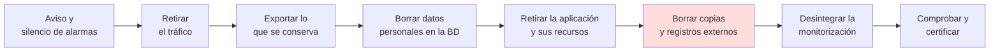

# UD05 · Terminación del contenedor

## Resumen del tema

Todo servicio termina: acaba un contrato, se sustituye por otro o deja de usarse. Darlo de baja **bien** es tan importante como desplegarlo: hay que **liberar todos los recursos** que ocupaba, **borrar de forma irrecuperable** las copias, los registros y los datos personales que haya ido acumulando, y **desconectarlo** de la monitorización para que no queden alarmas huérfanas ni paneles vacíos. Una baja mal hecha deja datos personales en un almacén que nadie recuerda, discos que se siguen pagando y alarmas que avisan de un servicio que ya no existe.



### Objetivos de aprendizaje

- Planificar la baja de un servicio contenerizado con su inventario y su orden de operaciones.
- Identificar los recursos que sobreviven a un `kubectl delete`.
- Borrar datos personales de una base de datos y saber por qué `DELETE` no basta.
- Eliminar copias y registros de sistemas externos de forma que no se puedan restaurar, conociendo los límites del borrado.
- Retirar todas las referencias del servicio de la monitorización y las alarmas.
- Comprobar la baja y documentarla con un certificado de borrado.

---

## 1. El plan de baja

La baja es una operación **irreversible** a partir de cierto punto, así que se planifica y se aprueba por escrito. El plan tiene cuatro partes:

1. **Inventario**: todo lo que el servicio ha creado o usado, dónde está, si contiene datos personales y cómo se elimina y se comprueba. El libro de operaciones de las unidades anteriores es la fuente: cada capítulo añadió algo que ahora hay que quitar.
2. **Lo que se conserva**: datos que el cliente quiere quedarse (en un formato que pueda usar y **sin datos personales** si no hay base legal para conservarlos) y documentación.
3. **Orden de las operaciones**: de lo reversible a lo irreversible.
4. **Punto de no retorno** y **aprobación**: a partir del borrado de las copias no hay vuelta atrás.

## 2. Lo que sobrevive a `kubectl delete`



Borrar el espacio de nombres `bicialacant` elimina sus Pods, Services, Deployments, Secrets y PVC. Pero muchas cosas **no están dentro** del espacio de nombres:

| Recurso | Por qué sobrevive | Cómo se elimina |
|---|---|---|
| **PersistentVolume** con `reclaimPolicy: Retain` | Está pensado para conservar los datos al borrar el PVC | Borrar el PV **y** los datos del almacenamiento que lo respalda |
| Datos del volumen en el nodo (aprovisionador local) | Con `Delete` se borra el directorio, pero no se sobrescribe | Borrado seguro antes, o borrado criptográfico |
| **Imágenes** en los nodos y en el registro | La caché de cada nodo y el registro son independientes del clúster | `crictl rmi` en los nodos, borrado en el registro |
| Objetos en **otros espacios de nombres** | `PrometheusRule`, `CronJob` de revisión, paneles de Grafana, rutas de Alertmanager | Borrarlos uno a uno (el inventario los lista) |
| **Copias** en el almacén externo | Están fuera del clúster, a propósito | Borrar objetos, depósito y claves |
| Copias y programaciones de **Velero** | Viven en el espacio `velero` y en el almacén | `velero schedule delete` y `velero backup delete` |
| **Registros** en Loki y **series** en Prometheus | Se conservan según su retención | API de borrado de cada uno |
| Correos de alarmas e informes | En el buzón (Mailpit) | Borrar los mensajes |
| Configuración fuera del clúster | `/etc/hosts`, fail2ban, DNS, certificados | Revisión manual con el inventario |

## 3. Borrar datos personales en una base de datos

El RGPD obliga a no conservar datos personales más tiempo del necesario y a poder demostrar que se han suprimido. En PostgreSQL:

- `DELETE` **marca** las filas como muertas, pero siguen en los ficheros de datos hasta que se reutiliza el espacio. Un análisis forense del fichero podría recuperarlas.
- `VACUUM FULL` **reescribe** la tabla en ficheros nuevos y libera los antiguos. `CHECKPOINT` asegura que los cambios están en disco.
- Los datos también están en el **registro de transacciones** (WAL) y en **todas las copias** anteriores: borrarlos en la base de datos no sirve si se conservan las copias.
- Si el cliente necesita estadísticas, se generan **antes** datos **anónimos** (agregados sin posibilidad de identificar a nadie), no seudónimos.

Por eso, en una baja completa, el borrado en la base de datos es solo el primer paso: después se elimina el **volumen** entero y todas las **copias**.

## 4. Borrado seguro y sus límites

| Técnica | Qué hace | Limitación |
|---|---|---|
| Borrado lógico (`rm`, `DELETE`, borrar un objeto) | Quita la referencia; los datos siguen en el soporte hasta que se sobrescriben | Recuperable con herramientas forenses |
| Sobrescritura (`shred`, `dd`) | Escribe encima del fichero o del disco | En **SSD**, sistemas con copia en escritura (btrfs, ZFS), capas de contenedores y almacenes de objetos, la escritura va a **otros** bloques: los originales pueden quedar |
| **Borrado criptográfico** | Los datos se guardan **cifrados** y, al terminar, se destruye la **clave** | Exige haber cifrado desde el principio |
| Destrucción del soporte | Física o del disco virtual completo | Solo cuando el soporte es exclusivo del servicio |

En sistemas de contenedores y en la nube no controlas los bloques físicos, así que la práctica recomendada es el **borrado criptográfico**: copias cifradas antes de salir del clúster, volúmenes cifrados por el proveedor con una clave por servicio y, al dar de baja, destruir la clave. Lo que no se pueda garantizar se documenta en el certificado como **limitación conocida**.

### 4.1 Copias en el almacén de objetos

Borrar un objeto S3 lo hace inaccesible de inmediato; el almacén libera sus bloques más tarde (en Garage, el recolector de bloques los elimina pasado un tiempo). Si el depósito tuviera **versionado** o **bloqueo de objetos**, habría que borrar también las versiones anteriores, o esperar a que caduque el bloqueo: lo que te protegía contra el *ransomware* ahora retrasa la baja, y hay que tenerlo previsto en la política. Al final se borran el **depósito** y la **clave de acceso**.

### 4.2 Registros y métricas

- **Loki**: con `allow_deletes`, la API `POST /loki/api/v1/delete?query={namespace="bicialacant"}` crea una petición de borrado que el **compactador** ejecuta tras un plazo de cancelación.
- **Prometheus**: con la API de administración activada, `POST /api/v1/admin/tsdb/delete_series?match[]={namespace="bicialacant"}` marca las series y `clean_tombstones` las elimina del disco.

Las métricas de BiciAlacant no contienen datos personales, pero dejar sus series provoca paneles con datos de un servicio que no existe y alarmas como `absent()` que saltan para siempre.

## 5. Desintegrar la monitorización



Es la operación inversa de la UD01. Cada cosa que se añadió para observar el servicio se quita, **en este orden**:

1. **Silenciar** las alarmas del servicio en Alertmanager durante la baja, para no despertar a la guardia por algo planificado.
2. Retirar los **objetivos**: el `ServiceMonitor` (desaparece con el espacio de nombres) y la política de red que permitía el *scrape*.
3. Borrar las **reglas**: `PrometheusRule` de indicadores, SLO y copias.
4. Quitar las **rutas** y receptores específicos de Alertmanager.
5. Borrar **paneles**, **alertas de Grafana** y el **CronJob** de revisión diaria.
6. **Comprobar**: ningún objetivo, regla, alarma, serie ni ruta que mencione el servicio. Después, quitar el silencio: si salta algo, es una referencia olvidada.

> [!WARNING]
> Las alarmas con `absent()` (por ejemplo, `BiciAlacantApiSinDatos`) **saltan precisamente cuando el servicio desaparece**. Si borras la aplicación antes que las reglas, la baja genera alarmas críticas. Silencia primero y borra las reglas antes de quitar el silencio.

## 6. Comprobar y certificar

La baja se **comprueba** con una lista automatizada (el *script* `comprobar-baja.sh` revisa clúster, nodos, monitorización, almacén y equipo) y se **documenta** con un **certificado de borrado**: qué datos había en cada soporte, con qué método se borraron, cómo se comprobó, qué limitaciones tiene el método y qué se ha conservado. El certificado, el plan y las evidencias cierran el libro de operaciones.

## 7. Errores frecuentes

| Error | Consecuencia | Solución |
|---|---|---|
| Borrar el espacio de nombres y dar la baja por terminada | Quedan copias, imágenes, reglas, registros y PV | Inventario y comprobación automatizada |
| Borrar la aplicación antes que las reglas | Alarmas críticas de `absent()` | Silenciar y borrar reglas primero |
| `DELETE` sin `VACUUM FULL` | Datos recuperables del fichero | `VACUUM FULL` y, después, borrar el volumen |
| Borrar los datos pero no las copias | Los datos personales siguen existiendo | Las copias están en el inventario |
| Confiar en `shred` sobre un SSD o una capa de contenedor | Falsa sensación de seguridad | Borrado criptográfico o limitación documentada |
| Borrar las copias antes de exportar lo que se conserva | Se pierde lo que el cliente quería | Exportar y verificar la exportación antes del punto de no retorno |

## 8. Resumen

- La baja se **planifica**: inventario, lo que se conserva, orden de operaciones, punto de no retorno y aprobación.
- Muchas cosas sobreviven a `kubectl delete`: PV, imágenes, objetos en otros espacios, copias, registros, series y correos.
- `DELETE` no borra físicamente; `VACUUM FULL` reescribe, pero quedan copias y WAL: al final se borra el volumen.
- El borrado seguro tiene límites en SSD, capas y almacenes de objetos; la garantía real es el **borrado criptográfico**.
- La monitorización se **desintegra** en orden inverso, con las alarmas silenciadas, hasta que no queda ninguna referencia.
- Se **comprueba** con un *script* y se **certifica** por escrito.

## 9. Autoevaluación


- q: "Tras `kubectl delete namespace bicialacant`, ¿qué sigue existiendo seguro?"
  options: ["Los Pods de la API", "El Secret db-cred", "Las copias en Garage y las PrometheusRule del espacio monitorizacion", "El Service web"]
  answer: 2
  explain: "Están fuera del espacio de nombres: hay que borrarlas aparte."
- q: "¿Por qué no basta `DELETE FROM abonado` para eliminar los datos personales?"
  options: ["Porque no borra nada", "Porque las filas quedan marcadas como muertas en los ficheros y además siguen en las copias", "Porque necesita `TRUNCATE`", "Porque PostgreSQL no permite borrar"]
  answer: 1
  explain: "Hay que reescribir la tabla (`VACUUM FULL`), borrar el volumen y eliminar las copias."
- q: "¿Qué técnica da garantías reales de borrado en un almacén de objetos de la nube?"
  options: ["`shred` sobre el objeto descargado", "Borrado criptográfico: los datos estaban cifrados y se destruye la clave", "Renombrar el depósito", "Vaciar la papelera"]
  answer: 1
  explain: "No controlas los bloques físicos; sin la clave, los datos cifrados son ilegibles."
- q: "Borras la API y al momento salta `BiciAlacantApiSinDatos` (crítica). ¿Qué ha fallado en el plan?"
  options: ["Nada, es normal", "No se silenciaron las alarmas ni se borraron las reglas antes de retirar la aplicación", "Prometheus está caído", "Falta el ServiceMonitor"]
  answer: 1
  explain: "Las reglas con `absent()` saltan cuando el servicio desaparece: silenciar y borrar reglas primero."
- q: "¿Qué debe recoger el certificado de borrado además de lo que se ha borrado?"
  options: ["Solo la firma", "El método, la comprobación, las limitaciones conocidas y lo que se ha conservado", "Las contraseñas usadas", "El código de la aplicación"]
  answer: 1
  explain: "Así se puede demostrar qué se hizo y con qué garantías."


## Referencias

- Reglamento General de Protección de Datos, art. 5 (limitación del plazo de conservación) y art. 17 (supresión) — <https://www.boe.es/doue/2016/119/L00001-00088.pdf>
- AEPD: guía sobre borrado seguro y destrucción de la información — <https://www.aepd.es/>
- NIST SP 800-88 Rev. 1, *Guidelines for Media Sanitization* — <https://csrc.nist.gov/pubs/sp/800/88/r1/final>
- PostgreSQL: `VACUUM` — <https://www.postgresql.org/docs/current/sql-vacuum.html>
- Grafana Loki: *Log entry deletion* — <https://grafana.com/docs/loki/latest/operations/storage/logs-deletion/>
- Prometheus: *TSDB Admin APIs* — <https://prometheus.io/docs/prometheus/latest/querying/api/#tsdb-admin-apis>
- Kubernetes: *Persistent Volumes* (políticas de recuperación) — <https://kubernetes.io/docs/concepts/storage/persistent-volumes/#reclaiming>
